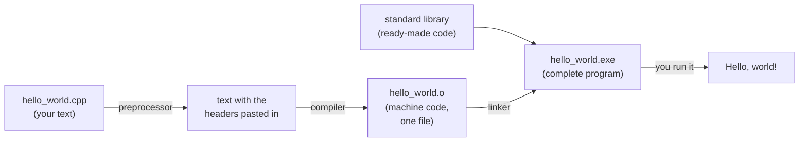

# Handout 1: Hello, C++

**Session length:** about 60 minutes. **Prerequisite:** the setup page for your IDE ([Qt Creator](../setup/qtcreator.md) or [VSCode](../setup/vscode.md)).

After this session you can:

- explain every line of a minimal C++ program,
- compile and run it (in your IDE and from the command line),
- print neatly formatted tables, and read a first calculation,
- recognise the three most common beginner compiler errors.

All programs of this handout are in [`examples/01-hello`](../examples/01-hello). Each is its own build target.

---

## 1. Why C++ in research and engineering?

C++ programs are compiled to machine code, run fast, and give you control over memory and numbers. Much scientific and engineering software, from molecular dynamics and image processing to instrument and bionic-interface firmware, is written in it. The price is that you must be more precise than in a scripting language, and the compiler will tell you when you are not. This handout series teaches you to work with that, not against it.

---

## 2. The smallest program

[`hello_world.cpp`](../examples/01-hello/hello_world.cpp)

```cpp
#include <iostream>

int main()
{
    std::cout << "Hello, world!\n";
    return 0;
}
```

Output:

```text
Hello, world!
```

### Line by line

| Code | Meaning |
|---|---|
| `#include <iostream>` | Paste the declarations for input/output streams here. Without it the compiler does not know `std::cout`. |
| `int main()` | The entry point: every program starts here. `int` says it hands back an integer to the system. |
| `{ ... }` | The body of the function. Braces group statements. |
| `std::cout` | "Standard output": normally the console. Lives in the namespace `std`. |
| `<<` | "Send to": pushes the text on the right into the stream on the left. Can be chained. |
| `"Hello, world!\n"` | A text (string literal). `\n` is the newline character. |
| `;` | Ends a statement. Forgetting it is the classic first error. |
| `return 0;` | Hand the value 0 back to the system. 0 means "success". |

Whitespace and indentation are ignored by the compiler but essential for humans. Use four spaces per level and one statement per line.

### Four ideas worth understanding

**`#include` and headers**

- **Idea:** C++ is split into many small libraries. A header such as `<iostream>` tells the compiler what a library offers, so you only pull in what you use.
- **Trouble:** forget the include and you get an error that mentions the *name* (`'cout' is not a member of 'std'`), not the missing include. A header you include by accident through another header may hide the problem on one compiler and expose it on another.
- **In practice:** include every header whose features you use, in alphabetical order, one per line. `<...>` is for library headers, `"..."` for your own files.

**The namespace `std::`**

- **Idea:** a namespace is a surname for names. The standard library keeps everything in `std`, so `std::cout` cannot clash with a `cout` of your own.
- **Trouble:** you will see `using namespace std;` in many tutorials. It saves typing, but in larger programs it can silently make different libraries' names collide, and it hides where a name comes from.
- **In practice:** write `std::` in these handouts. You will read it fast in a few days. In a tiny `.cpp` file of your own, `using std::cout;` (one name only) is an acceptable compromise.

**`main` and its return value**

- **Idea:** the operating system starts your program by calling `main`. The returned integer is the **exit code**. By convention 0 is success and anything else means failure. Scripts and other programs can check it.
- **Trouble:** C++ lets you leave out `return 0;` in `main` (it is assumed). This is the only function where that works, which confuses beginners who copy the habit elsewhere.
- **In practice:** write `return 0;` explicitly for now, and `return 1;` when something went wrong (you will see this in the `greeting` example).

**Streams: `\n` versus `std::endl`**

- **Idea:** `std::cout` is a *stream* of characters. `<<` appends to it. Both `'\n'` and `std::endl` start a new line.
- **Trouble:** `std::endl` also **flushes** the stream, forcing the text out immediately. That is slow if you print thousands of lines, and is a typical reason for a "slow" program that writes a lot of results.
- **In practice:** use `'\n'` (a single character) or `"...\n"`. Use `std::endl` only if you really need the output to appear right now, for example before a long calculation.

---

## 3. From text to program

You write *source code*, a text file. The computer needs machine code. Three tools turn one into the other:



- **Preprocessor:** handles lines that begin with `#`.
- **Compiler:** translates C++ into machine code and reports errors in *your* code.
- **Linker:** combines your machine code with library code. Errors here say "undefined reference" and usually mean a function was declared but never defined.

Your IDE runs all three when you press Build. You can also do it by hand:

```powershell
g++ -std=c++17 -Wall -Wextra hello_world.cpp -o hello_world
.\hello_world.exe
```

| Flag | Meaning |
|---|---|
| `-std=c++17` | Use the C++17 version of the language. |
| `-Wall -Wextra` | Turn on useful warnings. Treat them as hints and read them. |
| `-o hello_world` | Name of the output program. |

### In your IDE

| | Qt Creator | VSCode |
|---|---|---|
| Choose program | kit/target selector, bottom left | target name in the blue status bar |
| Build | `Ctrl+B` | **Build** in status bar, or `F7` |
| Run | green ▶ (builds first) | ▶ in status bar |
| Debug | ▶ with bug, `F5` | bug icon in status bar |
| Output appears in | *Application Output* pane | terminal panel |
| Programs that read input | tick **Run in terminal** under *Projects → Run* | works directly |

---

## 4. Core example: the elements of life

[`element_table.cpp`](../examples/01-hello/element_table.cpp) prints a table of the five elements most important in biochemistry, and calculates the molar mass of water.

```cpp
#include <iomanip>
#include <iostream>
#include <string>

int main()
{
    // Header
    std::cout << std::left << std::setw(4) << "Z" << std::setw(8) << "Symbol"
              << std::setw(12) << "Name" << std::right << std::setw(8) << "Mass" << '\n';
    std::cout << std::string(32, '-') << '\n';

    // Five rows. Numbers: right-aligned, three decimals.
    std::cout << std::fixed << std::setprecision(3);
    std::cout << std::left << std::setw(4) << 1 << std::setw(8) << "H" << std::setw(12) << "Hydrogen"
              << std::right << std::setw(8) << 1.008 << '\n';
    // ... rows for C, N, O and P follow the same pattern (see the file) ...

    // A first calculation with named values (variables).
    const double mass_h = 1.008;
    const double mass_o = 15.999;
    const double water = 2 * mass_h + mass_o;

    std::cout << "\nMolar mass of H2O: " << water << " g/mol\n";
    return 0;
}
```

Output:

```text
Z   Symbol  Name            Mass
--------------------------------
1   H       Hydrogen       1.008
6   C       Carbon        12.011
7   N       Nitrogen      14.007
8   O       Oxygen        15.999
15  P       Phosphorus    30.974

Molar mass of H2O: 18.015 g/mol
```

(Atomic weights are rounded to three decimals from the standard values of the IUPAC Commission on Isotopic Abundances and Atomic Weights.)

### What is new

| Code | Meaning |
|---|---|
| `#include <iomanip>` | Output *manipulators* for formatting. |
| `std::setw(8)` | The **next** item is printed in a field 8 characters wide. |
| `std::left`, `std::right` | Align text inside the field to the left or right. |
| `std::fixed`, `std::setprecision(3)` | Print decimals in fixed notation with 3 digits after the point. |
| `std::string(32, '-')` | A text consisting of 32 dashes. Needs `<string>`. |
| `const double mass_h = 1.008;` | A **variable**: a named value. `double` means a decimal number, `const` means it cannot change later. |
| `2 * mass_h + mass_o` | Arithmetic works as expected: `*` before `+`, parentheses to override. |

### Formatting: Idea / Trouble / In practice

- **Idea:** manipulators change *how* numbers and text are printed, not their values, so the table lines up like a lab report.
- **Trouble:** most manipulators are **sticky**. `std::fixed` and `std::setprecision(3)` stay in force for every later number, which is why the water mass also shows three decimals. `std::setw` is the exception: it applies only to the next item, which is why it is repeated for every column. Also, `std::left`/`std::right` stay until you change them again.
- **In practice:** set the format once before a block of output, and write it down in a comment. When many lines look alike (as here), that is the signal to use a loop or a function, which you will meet in the next two handouts.

---

## 5. Reading compiler errors

The compiler is picky but helpful. Three typical mistakes, with the **real** messages from g++ 13 (paths shortened).

**1. A missing semicolon**

```text
e1_semicolon.cpp:5:35: error: expected ';' before 'return'
    5 |     std::cout << "Hello, world!\n"
      |                                   ^
      |                                   ;
    6 |     return 0;
      |     ~~~~~~
```

Read: `file:line:column: error: message`. The compiler even draws the place where it expects the `;`. Notice that it points at the *end of line 5*, although the statement that triggered the error is on line 6.

**2. Forgetting `std::`**

```text
e2_no_std.cpp:5:5: error: 'cout' was not declared in this scope; did you mean 'std::cout'?
    5 |     cout << "Hello, world!\n";
      |     ^~~~
      |     std::cout
```

**3. Forgetting the `#include`**

```text
e3_no_include.cpp:3:10: error: 'cout' is not a member of 'std'
    3 |     std::cout << "Hello, world!\n";
      |          ^~~~
e3_no_include.cpp:1:1: note: 'std::cout' is defined in header '<iostream>'; did you forget to '#include <iostream>'?
```

### Rules of thumb (simple practical guidelines)

1. **Read the first error first.** Later errors are often consequences of the first one. Fix it, rebuild, repeat.
2. The message gives `line:column`. The real mistake can be slightly *before* that place.
3. Read the part after the colon literally. Words like "did you mean" or "did you forget" are usually right.
4. A *warning* is not an error, but treat it as a bug report until you understand it.

---

## 6. Extra examples

Pick whatever interests you. They are complete programs.

### 6.1 Reading input: [`greeting.cpp`](../examples/01-hello/greeting.cpp)

```cpp
#include <iostream>
#include <string>

int main()
{
    std::cout << "What is your name? ";
    std::string name;
    std::getline(std::cin, name);
    std::cout << "Hello, " << name << "!\n";

    std::cout << "Enter two numbers: ";
    double a = 0.0;
    double b = 0.0;
    if (!(std::cin >> a >> b)) {
        std::cerr << "That was not a number.\n";
        return 1; // a non-zero return value tells the system that something went wrong
    }
    std::cout << a << " + " << b << " = " << a + b << '\n';
    return 0;
}
```

Typing `Ada Lovelace`, then `3.5 4.25`:

```text
What is your name? Hello, Ada Lovelace!
Enter two numbers: 3.5 + 4.25 = 7.75
```

Typing `Ada`, then `abc`:

```text
What is your name? Hello, Ada!
Enter two numbers: That was not a number.
```

(the exit code is 1 in this case).

**What to notice**

- `std::cin >> a >> b` is the mirror image of `std::cout`: data flows *from* the stream into the variables.
- `std::getline` reads a whole line, including spaces. `std::cin >> name` would stop at the first space.
- Reading can **fail**, and then the stream is in an error state that the `if` can test. Real data is never as clean as you hope.
- `std::cerr` is the error channel: the same console by default, but it can be separated from normal output.
- Initialise variables (`= 0.0`). A variable you forgot to set holds garbage, a very common bug source. We return to it in handout 2.
- In Qt Creator, tick **Run in terminal** or you cannot type anything.

### 6.2 A table of squares: [`squares.cpp`](../examples/01-hello/squares.cpp)

```cpp
#include <cmath>
#include <iomanip>
#include <iostream>

int main()
{
    std::cout << std::setw(4) << "n" << std::setw(6) << "n^2" << std::setw(10) << "sqrt(n)" << '\n';
    std::cout << std::fixed << std::setprecision(4);
    for (int n = 1; n <= 10; ++n) {
        std::cout << std::setw(4) << n << std::setw(6) << n * n << std::setw(10) << std::sqrt(n) << '\n';
    }
    return 0;
}
```

Output:

```text
   n   n^2   sqrt(n)
   1     1    1.0000
   2     4    1.4142
   3     9    1.7321
   4    16    2.0000
   5    25    2.2361
   6    36    2.4495
   7    49    2.6458
   8    64    2.8284
   9    81    3.0000
  10   100    3.1623
```

**What to notice**

- The same formatting tools as in section 4, but the **loop** writes the repeated rows for you. Compare this with the five copy-pasted rows of the element table.
- `for (int n = 1; n <= 10; ++n)` reads: start with `n = 1`, repeat while `n <= 10`, add one after each round (`++n`). Handout 2 covers loops in detail.
- `std::sqrt` lives in `<cmath>`. `n * n` is an integer product, `std::sqrt(n)` returns a decimal number.

---

## 7. Looking ahead: same problem, new tool

The element table is the **"before"** picture of a problem we will return to. Five nearly identical `std::cout` blocks are tedious to write and easy to get wrong. In handout 4 the same table becomes a few lines: the data sit in a `std::vector` and a loop prints them. The more data, the more the new tool pays off (becomes worthwhile).

---

## 8. Summary

- A C++ program is text → preprocessor → compiler → linker → executable.
- `#include` brings in features, `std::` names where they come from, `main` is the entry point, and `<<` pushes data into a stream.
- Use `'\n'` rather than `std::endl`. Manipulators are mostly sticky, but `setw` is not.
- When the compiler complains, read the first error, at its `line:column`, and read the words literally.
- Everything here builds the same way in Qt Creator, VSCode and on the command line.

## References

Checked on 2026-11-22 (address reachable, title matches):

1. Bjarne Stroustrup, *A Tour of C++*, 3rd edition, Addison-Wesley, 2022, ISBN 0-13-681648-7. <https://www.stroustrup.com/tour3.html>
2. cppreference.com: [`std::cout`](https://en.cppreference.com/w/cpp/io/cout), [`std::setw`](https://en.cppreference.com/w/cpp/io/manip/setw), [`std::setprecision`](https://en.cppreference.com/w/cpp/io/manip/setprecision), [`std::fixed`](https://en.cppreference.com/w/cpp/io/manip/fixed).
3. IUPAC Commission on Isotopic Abundances and Atomic Weights (CIAAW), *Standard Atomic Weights*. <https://ciaaw.org/atomic-weights.htm>
4. Standard C++ Foundation, *Tour of C++* resources. <https://isocpp.org/tour>
5. CMake documentation: [`cmake-presets`](https://cmake.org/cmake/help/latest/manual/cmake-presets.7.html).
