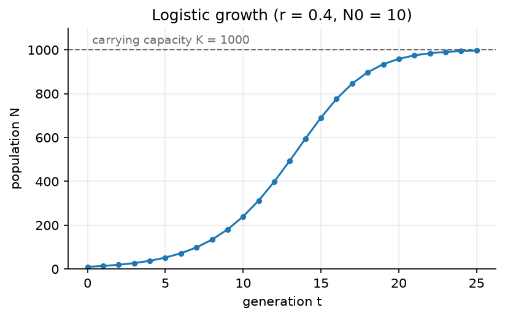
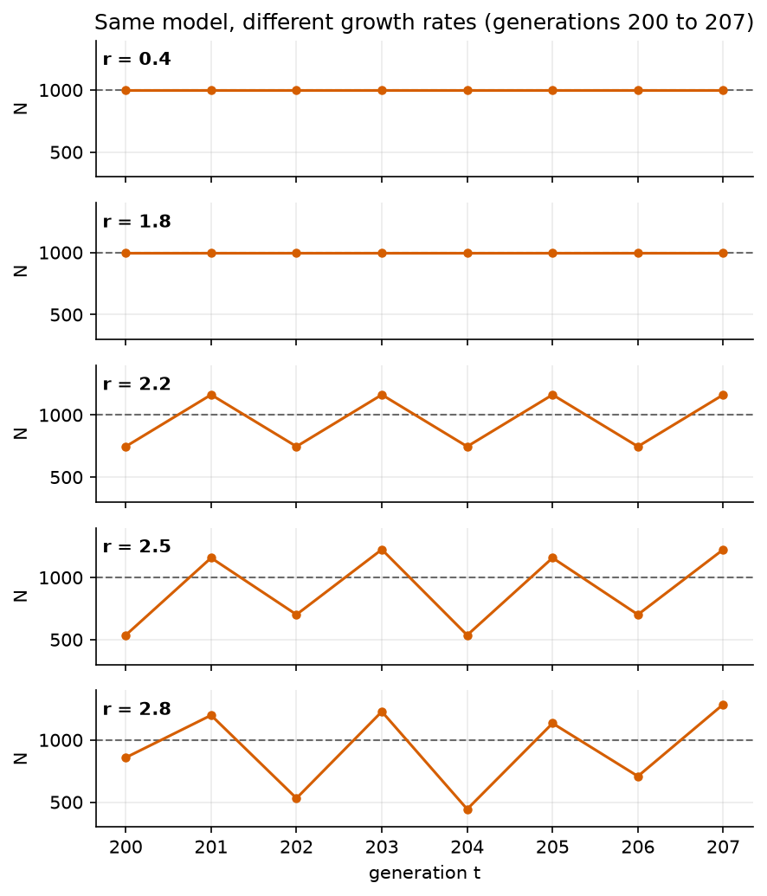
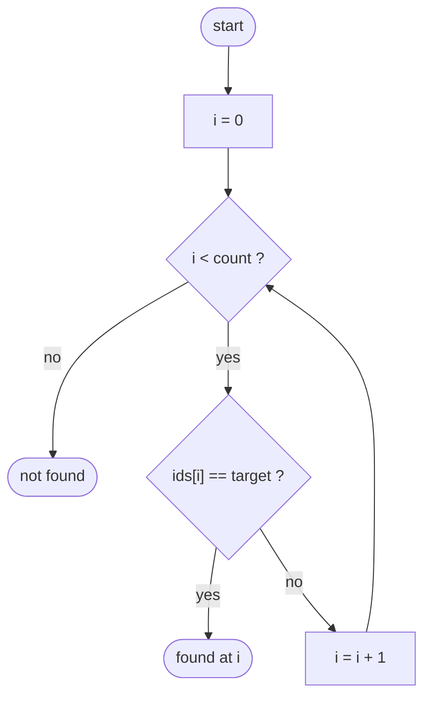
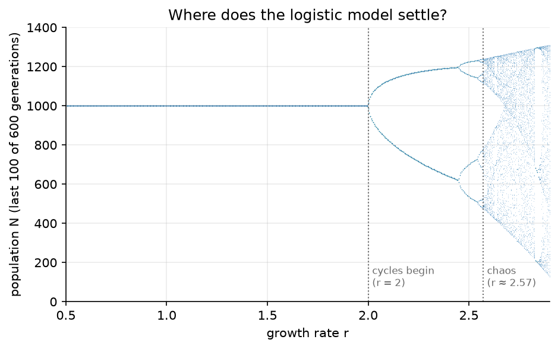

# Handout 2: The Basics in a Nutshell (in short)

**Session length:** about 60 minutes. **Prerequisite:** [Handout 1](01-hello.md).

You already know variables, `if`/`else` and loops from another language. This handout shows how C++ spells them, and where C++ differs in ways that matter for numerical work. Then two real problems follow: a population model and a search.

After this session you can:

- declare and initialise variables of the basic types,
- write conditions and loops, and avoid the classic traps (`=` vs `==`, integer division, off-by-one),
- simulate a simple growth model with a loop,
- search an array element by element and count the work done.

All programs are in [`examples/02-basics`](../examples/02-basics). `tour.cpp` contains every snippet of section 1 and can be run as is.

---

## 1. The quick tour

### 1.1 Types and variables

```cpp
int count = 12;              // whole numbers
double concentration = 0.25; // decimal numbers (mol/L)
bool is_ready = true;        // true or false
char base = 'A';             // a single character
std::string gene = "BRCA1";  // text (needs #include <string>)
```

- **Idea:** every variable has a **type** fixed when it is declared. The type decides what values it can hold, how much memory it uses and how arithmetic on it behaves.
- **Trouble:** unlike in a scripting language you cannot put a number into a text variable later. And a variable you declare **without a value** (`int n;`) contains whatever was in memory before, which gives different results from run to run. The compiler may or may not warn you.
- **In practice:** give every variable a value where you declare it (`int n = 0;`). Use `double` for all measured and computed quantities, `int` for counts and indices. Use `const` for anything that should not change. A good name (`concentration`) is worth more than a comment.

### 1.2 Operators and the division trap

```cpp
int a = 7;
int b = 2;
std::cout << a / b;    // 3    integer division: decimals cut off
std::cout << a % b;    // 1    remainder
std::cout << a / 2.0;  // 3.5  one decimal operand makes the division decimal

count += 3; // same as count = count + 3;
++count;    // same as count = count + 1;
```

- **Idea:** the usual `+ - * /` work, plus `%` (remainder of integer division) and shortcuts such as `+=` and `++`.
- **Trouble:** if **both** operands are integers, `/` is an integer division and the decimals are silently thrown away. `3 / 4` is `0`, not `0.75`. This is the most common silent error in numerical code. The compiler does not complain because the program is perfectly legal.
- **In practice:** compute with `double`. When you have integer counts, convert one of them: `static_cast<double>(total) / n`, or multiply by `1.0` first. Be careful with the order: `3 / 4 * 100` is `0`, while `100.0 * 3 / 4` is `75`. See extra example 6.1.

### 1.3 Conditions

```cpp
double ph = 6.4;
if (ph < 7.0) {
    std::cout << "acidic\n";
} else if (ph > 7.0) {
    std::cout << "basic\n";
} else {
    std::cout << "neutral\n";
}

if (ph > 6.0 && ph < 8.0) { // && = and, || = or, ! = not
    std::cout << "within the physiological window\n";
}
```

- **Idea:** `if` runs a block only if a condition holds. Conditions are built with `== != < <= > >=` and combined with `&&`, `||`, `!`.
- **Trouble:** `=` assigns, `==` compares. Writing `if (x = 5)` is legal, assigns 5 and is always true. Turn on `-Wall`, which warns about it. A second trap: comparing decimals with `==` (`0.1 + 0.2 == 0.3` is false) because decimal numbers are stored with limited precision. Handout 7 and the floating-point note come back to this.
- **In practice:** always write braces, even for a single statement. Compare `double` values with `<` and `>`, or with a tolerance, not with `==`. Compare integers freely.

### 1.4 Loops

```cpp
int sum = 0;
for (int i = 1; i <= 5; ++i) { // counting loop: start; keep going while; step
    sum += i;
}

int n = 100;
int halvings = 0;
while (n > 1) {                // loop while a condition holds
    n /= 2;
    ++halvings;
}

for (int i = 1; i <= 10; ++i) {
    if (i % 2 == 0) { continue; } // skip to the next round
    if (i > 7)      { break; }    // leave the loop
    std::cout << i << '\n';
}
```

Output of the whole tour (`tour.cpp`):

```text
count=12 concentration=0.25 is_ready=1 base=A gene=BRCA1
7 / 2   = 3
7 % 2   = 1
7 / 2.0 = 3.5
count after += 3 and ++: 16
pH 6.4: acidic
within the physiological window
1+2+3+4+5 = 15
100 can be halved 6 times before reaching 1
odd: 1
odd: 3
odd: 5
odd: 7
```

- **Idea:** `for` is for a known number of rounds, `while` for "until something happens". `break` and `continue` change the flow inside a loop.
- **Trouble:** **off-by-one** errors. `i <= 5` runs five rounds starting from 1, but `i < 5` runs four. Starting from 0 (`i = 0; i < n`) is the C++ convention. A `while` whose condition never becomes false runs forever. Press the stop button in your IDE, or `Ctrl+C` in a terminal.
- **In practice:** count from 0 with `<`, and say in a comment what the loop variable means. For `while`, check that something inside the loop really changes the condition.

### 1.5 Arrays: just enough (the minimum you need now)

```cpp
const int ids[] = {4017, 2093, 7781, 1250};   // four numbers in a row
std::cout << ids[0];                            // first element: 4017 (counting starts at 0)
const int count = static_cast<int>(std::size(ids)); // number of elements: 4 (needs <iterator>)
```

- **Idea:** an array holds several values of the same type under one name. `ids[i]` is element number `i`, counting from 0.
- **Trouble:** C++ does **not check** the index. `ids[4]` (one past the end) compiles and reads whatever lies next in memory. The program may "work" or crash, and different runs may differ. The size of an array is fixed when you write it.
- **In practice:** always keep the number of elements next to the array and loop `i < count`. In handout 4 you will meet `std::vector`, the everyday replacement that knows its size and can grow.

---

## 2. Core example: logistic population growth

### The problem

A bacterial culture grows in a flask with limited nutrients. At first it grows almost exponentially. As the population approaches the **carrying capacity** $K$ the growth slows and stops. How large is the population after each generation?

### Background

The classic description is the **logistic equation** by Verhulst. In continuous time, with population $N$, growth rate $r$ and capacity $K$:

$$\frac{dN}{dt} = r\,N\left(1 - \frac{N}{K}\right)$$

Computers work in steps, so we take one generation as one step. This gives the **discrete** version we program:

$$N_{t+1} = N_t + r\,N_t\left(1 - \frac{N_t}{K}\right)$$

The factor $\left(1 - N_t/K\right)$ is close to 1 for a small population (nearly unrestricted growth) and falls to 0 when $N_t = K$ (growth stops).

### The program

[`logistic_growth.cpp`](../examples/02-basics/logistic_growth.cpp): the first version of the **simulation thread**. Everything lives in `main` with plain variables.

```cpp
#include <iomanip>
#include <iostream>

int main()
{
    const double r = 0.4;           // growth rate per generation
    const double capacity = 1000.0; // carrying capacity K
    double population = 10.0;       // N at generation 0
    const int generations = 25;

    std::cout << std::setw(5) << "gen" << std::setw(12) << "population" << '\n';
    std::cout << std::fixed << std::setprecision(1);
    for (int t = 0; t <= generations; ++t) {
        std::cout << std::setw(5) << t << std::setw(12) << population << '\n';
        population = population + r * population * (1.0 - population / capacity);
    }
    return 0;
}
```

Output:

```text
  gen  population
    0        10.0
    1        14.0
    2        19.5
    3        27.1
    4        37.6
    5        52.1
    6        71.9
    7        98.6
    8       134.2
    9       180.6
   10       239.8
   11       312.7
   12       398.7
   13       494.6
   14       594.6
   15       691.0
   16       776.4
   17       845.9
   18       898.0
   19       934.6
   20       959.1
   21       974.8
   22       984.6
   23       990.7
   24       994.4
   25       996.6
```



The curve is drawn from the program output above (script: [`figures/make_figures.py`](../figures/make_figures.py)). It is S-shaped: nearly exponential at first, then flattening at the carrying capacity.

### Walkthrough

1. The parameters are `const double`: they are fixed during the run and have names that say what they mean. `1000.0` and not `1000`: writing the decimal point makes it a `double` immediately.
2. `population` is **not** `const`: it changes in every round.
3. The loop runs for `t = 0 ... 25`, so the table has 26 rows. Each round first **prints** the current population, then **updates** it.
4. The update is the formula, character by character. `population / capacity` is safe because both are `double`. Had `capacity` been an `int` in a world of integer populations, the ratio would be `0` (section 1.2).

### What happens for a larger growth rate?

The model is unchanged if we change one number. [`logistic_rates.cpp`](../examples/02-basics/logistic_rates.cpp) runs it for several values of $r$ and prints generations 200 to 207, long after the start-up:

```text
r = 0.4: generations 200..207:  1000.0  1000.0  1000.0  1000.0  1000.0  1000.0  1000.0  1000.0
r = 1.8: generations 200..207:  1000.0  1000.0  1000.0  1000.0  1000.0  1000.0  1000.0  1000.0
r = 2.2: generations 200..207:   746.2  1162.8   746.2  1162.8   746.2  1162.8   746.2  1162.8
r = 2.5: generations 200..207:   535.9  1157.7   701.2  1225.0   535.9  1157.7   701.2  1225.0
r = 2.8: generations 200..207:   858.2  1199.0   531.0  1228.3   443.2  1134.2   708.1  1286.8
```



For small $r$ the population settles at $K = 1000$. For $r = 2.2$ it flips between two values forever, for $r = 2.5$ between four, and for $r = 2.8$ it never repeats: it looks random although the rule is fully deterministic. This is **deterministic chaos**, described for this kind of model by Robert May in 1976. A single innocent-looking line of code can produce behavior that needs mathematics to explain, and your program will happily simulate it. The population may even overshoot $K$ (values above 1000 appear), which a real flask would never allow. That tells you the *discrete* model has limits.

For the mathematically curious: substituting $y_t = \dfrac{r\,N_t}{(1+r)\,K}$ turns the update into the classic logistic map $y_{t+1} = \mu\,y_t(1-y_t)$ with $\mu = 1 + r$. Period doubling begins at $\mu = 3$, that is at $r = 2$, and chaos sets in near $\mu \approx 3.57$.

---

## 3. Core example: linear search

### The problem

A lab keeps sample IDs in the order in which the samples were measured. Is a given ID in the list, and where?

### Background

The simplest method is **linear (sequential) search**: look at the first element, then the second, and so on, until you find the ID or run out of elements.



If the list has $n$ elements, the worst case (ID absent or last) needs $n$ comparisons. If the ID is present and equally likely to be anywhere, the average is about $n/2$. The work grows **in proportion to $n$**: ten times more samples, ten times more comparisons. We write this $O(n)$. Handout 3 shows that a sorted list allows a far faster method.

### The program

[`linear_search.cpp`](../examples/02-basics/linear_search.cpp): first version of the **search thread**.

```cpp
#include <iostream>
#include <iterator>

int main()
{
    // Sample IDs in the order in which the samples were measured.
    const int ids[] = {4017, 2093, 7781, 1250, 9034, 3318, 5521, 6402};
    const int count = static_cast<int>(std::size(ids));

    const int targets[] = {3318, 5521, 8888};

    for (int target : targets) {
        int found_at = -1; // -1 means "not found"
        int comparisons = 0;

        for (int i = 0; i < count; ++i) {
            ++comparisons;
            if (ids[i] == target) {
                found_at = i;
                break;
            }
        }

        if (found_at >= 0) {
            std::cout << "ID " << target << " found at position " << found_at;
        } else {
            std::cout << "ID " << target << " not found";
        }
        std::cout << " after " << comparisons << " comparisons\n";
    }
    return 0;
}
```

Output:

```text
ID 3318 found at position 5 after 6 comparisons
ID 5521 found at position 6 after 7 comparisons
ID 8888 not found after 8 comparisons
```

### Walkthrough

1. `std::size(ids)` gives the number of elements (8). It returns an unsigned type, so we convert with `static_cast<int>` to compare it safely with the `int` variable `i`.
2. `for (int target : targets)` is a **range-based for**: "for each element of `targets`". Handout 4 uses it all the time.
3. `found_at = -1` is a **marker value**: a legal-looking number that means "nothing". Positions start at 0, so `-1` can never be a real position. The price is that the marker must be checked (`found_at >= 0`). If you forget, you use `-1` as an index and read memory outside the array (section 1.5).
4. `break` leaves the inner loop as soon as the ID is found, so we do not waste comparisons.
5. The counter `comparisons` is how we **measure** the work. Position 5 needs 6 comparisons, and the missing ID 8888 needs all 8, exactly as the background predicts.

---

## 4. Same problem, new tool

You have now written the "before" versions of two problems that return in later handouts.

| Thread | Now (handout 2) | Next |
|---|---|---|
| Simulation | Everything in `main`, plain variables | Handout 3: the update becomes a function `step(...)`, which is easier to reuse and test |
| Search | Linear search written out in `main` | Handout 3: a function that returns the position, and **binary search** for sorted data. The comparison counts will show the difference |

---

## 5. Extra examples

Pick what interests you. Each is a complete program in `examples/02-basics`.

### 5.1 Integer or decimal? [`division_demo.cpp`](../examples/02-basics/division_demo.cpp)

Three plates have 12, 15 and 14 colonies. What is the mean? And what is the percentage 3 out of 4?

```text
total / 3            = 13   (integer division: decimals cut off)
total / 3.0          = 13.6667
double(total) / 3    = 13.6667
3 / 4 * 100          = 0   (3 / 4 is 0 first!)
100.0 * 3 / 4        = 75
3 * 100 / 4          = 75   (integer, but happens to be exact)
```

**What to notice**

- `total / 3` gives 13, not 13.67. The mean of integers calculated with integers is quietly wrong.
- `static_cast<double>(total)` converts a value to `double` for the rest of that expression.
- The **order** of operations matters: `3 / 4 * 100` first computes `3 / 4`, which is `0`. Multiplying by `100.0` first, or using a `double` anywhere early, fixes it.
- The last line is right only because 300 is divisible by 4. With other numbers integer division would cut off decimals again, so do not rely on it.

### 5.2 Fibonacci's rabbits: [`rabbits.cpp`](../examples/02-basics/rabbits.cpp)

A pair of rabbits needs one month to mature and then produces a new pair every month. Starting with one pair, how many pairs are there in month $n$? With $F_n = F_{n-1} + F_{n-2}$ we get the Fibonacci numbers, and the ratio of consecutive terms approaches the **golden ratio** $\varphi = (1+\sqrt{5})/2 \approx 1.618034$.

```text
 month         pairs     ratio
     1             1  1.000000
     2             2  2.000000
     3             3  1.500000
     4             5  1.666667
     5             8  1.600000
     6            13  1.625000
     7            21  1.615385
     8            34  1.619048
     9            55  1.617647
    10            89  1.618182
    15           987  1.618033
    20         10946  1.618034
    25        121393  1.618034
    30       1346269  1.618034
```

**What to notice**

- Two variables, `previous` and `current`, are enough: we do not need to store the whole sequence.
- The values are `long long` (a bigger integer type), because plain `int` would overflow later. An overflowing `int` does not complain, it just gives a wrong number.
- The ratio uses two `static_cast<double>`, exactly because of the integer-division trap above.
- The condition `month <= 10 || month % 5 == 0` combines `||` and `%` to print only some rows.

### 5.3 Half-life: [`half_life.cpp`](../examples/02-basics/half_life.cpp)

A hypothetical tracer has a half-life of 8 days. Starting with 100 mg, when is only 1 mg (1 %) left? The amount follows

$$N(t) = N_0\, 2^{-t/T_{1/2}}$$

so after one day a fraction $2^{-1/8} \approx 0.917$ remains.

```text
Daily factor:          0.917004
Days until <= 1 mg:    54 (loop)
Exact time to 1 mg:    53.1508 days (formula)
Amount after 54 days: 0.929068 mg
```

**What to notice**

- The `while (amount > limit)` loop is the natural choice when you do not know the number of rounds in advance.
- The loop counts **whole days**, so it reports 54. The formula $T_{1/2}\,\log_2(N_0/N)$ gives the exact 53.15. Both are "right", for different questions.
- `std::pow` and `std::log2` need `<cmath>`.

### 5.4 The 3n+1 problem: [`collatz.cpp`](../examples/02-basics/collatz.cpp)

Take any positive integer. If it is even, halve it. If it is odd, triple it and add 1. Repeat. It is conjectured that every start eventually reaches 1, but nobody has proven it.

```text
Longest chain below 31 starts at 27 with 111 steps
Highest value on the way: 9232
```

**What to notice**

- A start as small as 27 climbs up to 9232 before it collapses to 1, in 111 steps.
- Values can grow, which is why `n` is a `long long`.
- `(n % 2 == 0) ? n / 2 : 3 * n + 1` is the **conditional operator**: a compact `if`/`else` that produces a value. Use it for short expressions only.

### 5.5 The whole picture at once: [`logistic_bifurcation.cpp`](../examples/02-basics/logistic_bifurcation.cpp)

Instead of five growth rates, try 481 of them (r from 0.5 to 2.9). For each, let the population run for 500 generations, then print the next 100 values as CSV text (`r,population`). The program prints about 48 000 lines, so it is meant to be read by a plotting script, not by you. Run `figures/make_figures.py` (see the note at the end of this handout) and you get:



**What to notice**

- Up to $r = 2$ there is a single settled value, then the branch splits in two, then four, then eight, and beyond $r \approx 2.57$ the points fill a band: chaos. This repeated splitting is called **period doubling**.
- The loop structure is the same as before, only wrapped in an outer loop over `k`. The growth rate is computed as `0.5 + 0.005 * k` from an integer counter. Adding `0.005` 480 times would accumulate rounding error (see the floating-point note).
- `std::cout << r << ',' << population << '\n'` produces CSV with no formatting. Handout 5 shows how to write the same data to a file.

---

## 6. Summary

- Every variable has a type. Initialise it where you declare it, and use `const` where you can.
- **Integer division** cuts off the decimals. Make at least one operand `double`, and watch the order of operations.
- `=` assigns, `==` compares. Decimals are not compared with `==`.
- Loops: `for` for counting, `while` for waiting, and mind the off-by-one at `<` versus `<=`.
- Arrays are not bounds-checked. Keep their size at hand, and read the marker values you return.
- A simple loop can model growth. The same line of code can lead to a stable value, cycles or chaos, depending on a single parameter.
- Counting the comparisons tells you how the work of a search grows with the data. This is the first step to comparing algorithms.

### Note: regenerating the figures (optional)

The PNG files in `figures/` are committed, so you can read everything without Python. To redraw them from the programs' real output, after building the examples:

```powershell
.\.venv\Scripts\python.exe figures\make_figures.py
```

(Creating the `.venv` is described in [setup/python-venv.md](../setup/python-venv.md).)

## References

All addresses and DOIs were checked on 2026-11-22. Books were checked through publisher or library catalogues (title, edition and year).

1. R. M. May, "Simple mathematical models with very complicated dynamics", *Nature* **261**, 459-467 (1976). doi:[10.1038/261459a0](https://doi.org/10.1038/261459a0)
2. J. D. Murray, *Mathematical Biology I: An Introduction*, 3rd ed., Springer, 2002. doi:[10.1007/b98868](https://doi.org/10.1007/b98868). The logistic growth model is in the chapter on single-species population dynamics.
3. T. H. Cormen, C. E. Leiserson, R. L. Rivest, C. Stein, *Introduction to Algorithms*, 4th ed., MIT Press, 2022. ISBN 978-0-262-04630-5. Linear search and the cost of algorithms are discussed in the early chapters.
4. J. C. Lagarias, "The 3x + 1 problem and its generalizations", *The American Mathematical Monthly* **92**(1), 3-23 (1985). doi:[10.1080/00029890.1985.11971528](https://doi.org/10.1080/00029890.1985.11971528)
5. R. L. Graham, D. E. Knuth, O. Patashnik, *Concrete Mathematics: A Foundation for Computer Science*, 2nd ed., Addison-Wesley, 1994. ISBN 978-0-201-55802-9. The Fibonacci numbers and the golden ratio are treated in its chapter on special numbers.
6. B. Stroustrup, *A Tour of C++*, 3rd ed., Addison-Wesley, 2022. <https://www.stroustrup.com/tour3.html>
7. cppreference.com: [arithmetic operators](https://en.cppreference.com/w/cpp/language/operator_arithmetic), [arrays](https://en.cppreference.com/w/cpp/language/array), [`std::size`](https://en.cppreference.com/w/cpp/iterator/size), [`std::pow`](https://en.cppreference.com/w/cpp/numeric/math/pow), [`std::log2`](https://en.cppreference.com/w/cpp/numeric/math/log2).
