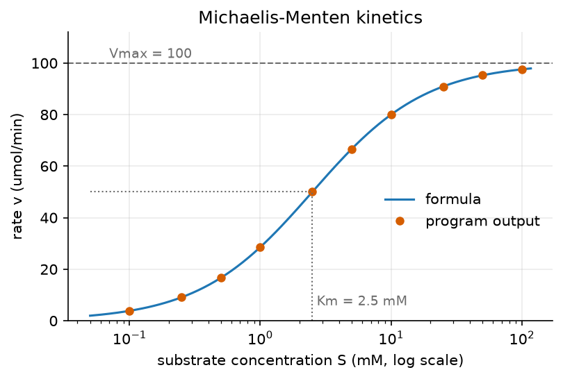
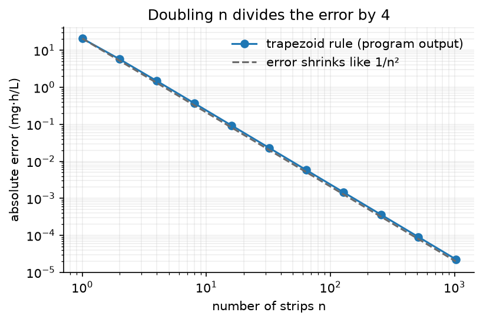
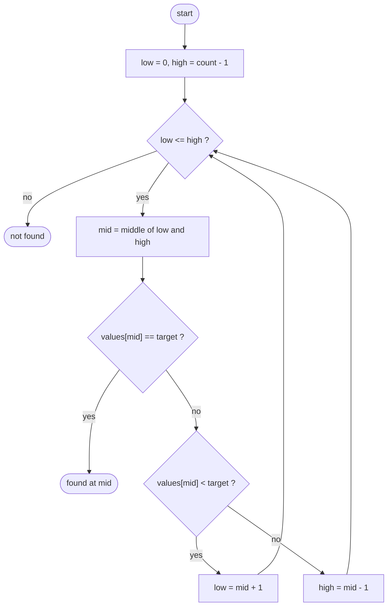

# Handout 3: Functions, References and `const`

**Session length:** about 60 minutes. **Prerequisite:** [Handout 2](02-basics.md).

In handout 2 everything lived in `main`. This handout teaches you to cut a program into **named, reusable pieces**. Then it uses them on three problems: enzyme kinetics, numerical integration and a faster search.

After this session you can:

- write a function with parameters and a return value, and call it,
- decide whether a parameter should be passed by value, by reference or by `const` reference,
- use default arguments and overloading,
- test a numerical method against a known exact answer,
- explain why binary search needs only about 10 steps for 1000 sorted values.

All programs are in [`examples/03-functions`](../examples/03-functions). Their build targets are named `03_<program>` (for example `03_trapezoid`), because target names must be unique in the whole project. The program files themselves keep the plain names (`trapezoid.exe`).

---

## 1. The quick tour

All snippets of this section are in [`tour.cpp`](../examples/03-functions/tour.cpp).

### 1.1 Writing a function

```cpp
// Declaration (prototype): the function exists, its body comes later.
double mean(double a, double b);

// Definition of a function with a return value.
int add(int a, int b)
{
    return a + b;
}

// A function that returns nothing: its return type is void.
void print_label(const std::string& label, double value)
{
    std::cout << label << " = " << value << '\n';
}
```

- **Idea:** a function packs a calculation under a name. It takes **parameters** (inputs), and may hand back a **return value**. The first line (return type, name, parameters) is the function's *signature*.
- **Trouble:** C++ reads a file from top to bottom. A function must be **declared before it is used**. Either define it above `main`, or put a *declaration* (prototype, the signature followed by `;`) above `main` and the definition anywhere below. Forgetting this gives `'mean' was not declared in this scope`. Also, the compiler checks that the arguments you pass fit the parameters: `add(2, 3, 4)` is an error.
- **In practice:** give a function **one job** and a name that says it (`michaelis_menten`, `trapezoid`, not `calc1`). Keep functions short enough to read at once. A function that computes should return its result, and leave printing to the caller.

### 1.2 Passing parameters: copy, reference, `const` reference

```cpp
void increment_copy(int n) { ++n; }   // by value: works on a COPY
void increment(int& n)     { ++n; }   // by reference: works on the ORIGINAL

int counter = 10;
increment_copy(counter);  // counter is still 10
increment(counter);       // counter is now 11
```

Output of `tour.cpp`:

```text
add(2, 3) = 5
after increment_copy: 10
after increment:      11
mean of 4 and 7 = 5.5
mean of 4, 7 and 10 = 7
0.25 mol/L in umol/L = 250000
0.25 in thousands = 250
```

- **Idea:** by default a parameter is a **copy** of the argument, so a function cannot change the caller's variable. A **reference** (`int&`, the `&` after the type) makes the parameter another name for the caller's own variable, so changes are visible outside.
- **Trouble:** a reference parameter hides the fact that the call can change a variable. From the call `increment(counter)` alone you cannot tell. And copying has a price: a big object (a long text, later a table of data) is copied in full at every call.
- **In practice:** three rules cover almost everything.
  1. Small values (`int`, `double`, `bool`): pass **by value**.
  2. Big values that the function only **reads**: pass by **`const` reference**: `const std::string& label`. There is no copy, and the compiler stops you from changing it.
  3. A value the function must **change or return as an extra result**: pass by reference (`int&`). Use this sparingly. If there is only one result, return it.

`const` on a parameter is a promise to the reader and a check by the compiler. If you use `const` wherever you can, every missing `const` tells you: "this one is changed somewhere".

### 1.3 Default arguments and overloading

```cpp
double to_micro(double value, double factor = 1.0e6)   // factor is optional
{
    return value * factor;
}

double mean(double a, double b);            // two values
double mean(double a, double b, double c);  // three values: same name, other parameters
```

- **Idea:** a **default argument** is used if the caller leaves it out: `to_micro(0.25)` uses `1.0e6`, `to_micro(0.25, 1000.0)` uses 1000. **Overloading** gives several functions the same name, and the compiler picks the one that fits the arguments.
- **Trouble:** defaults must be the **last** parameters. Too many defaults make a call hard to read: what do the numbers in `f(1.0, 2.0, 0.5, 3)` mean? Overloads that behave differently under one name are confusing too.
- **In practice:** use a default for a value that is nearly always the same (a standard temperature, a tolerance). Use overloading only when the functions really do the same thing for different inputs, like `mean` for two or three values. Write the default in the declaration only, not again in the definition.

### 1.4 Local variables and where a name is visible

- **Idea:** a variable declared **inside** a function (or inside any `{ }`) exists only there. This is its *scope*. Two functions can each have their own `x` and do not interfere.
- **Trouble:** the opposite also holds. A function cannot see the variables of `main`. If it needs a value, the value must come in as a parameter. (The example `trapezoid.cpp` uses two file-level `const double` values: constants declared outside every function are visible everywhere in the file, which is fine for fixed numbers that never change.)
- **In practice:** pass in what a function needs and return what it produces. Avoid file-level variables that change, because then any function may change them and bugs become hard to find. A file-level `const` is safe.

### 1.5 Arrays as parameters

```cpp
int linear_find(const int values[], int count, int target, int& comparisons);
```

- **Idea:** an array can be passed to a function, and the function reads (or changes) the original, with no copy. Declare it `const` if the function only reads it.
- **Trouble:** inside the function the array has become a plain *address* of its first element. **The size is lost**: `std::size(values)` does not work there. That is why `count` is a separate parameter. The compiler also does not check it.
- **In practice:** always pass an array together with its number of elements. Handout 4 introduces `std::vector`, which knows its size and removes this problem.

---

## 2. Core example: Michaelis-Menten enzyme kinetics

### The problem

An enzyme converts a substrate into a product. How fast is the reaction at a given substrate concentration, and how much substrate do we need to reach a given rate?

### Background

The classic model (Michaelis and Menten, 1913) gives the reaction rate $v$ as a function of the substrate concentration $[S]$:

$$v = \frac{V_{\max}\,[S]}{K_m + [S]}$$

- $V_{\max}$ is the maximal rate, reached when the enzyme is saturated with substrate.
- $K_m$ (the *Michaelis constant*) is the substrate concentration at which the rate is exactly $V_{\max}/2$: put $[S] = K_m$ into the formula.

Solving the formula for $[S]$ gives the inverse, the concentration needed for a target rate $v$:

$$[S] = \frac{K_m\,v}{V_{\max} - v}$$

### The program

[`michaelis_menten.cpp`](../examples/03-functions/michaelis_menten.cpp)

```cpp
// v = vmax * s / (km + s)
double michaelis_menten(double vmax, double km, double substrate)
{
    return vmax * substrate / (km + substrate);
}

// The inverse: which substrate concentration gives the rate v? (needs 0 <= v < vmax)
double substrate_for_rate(double vmax, double km, double rate)
{
    return km * rate / (vmax - rate);
}

int main()
{
    const double vmax = 100.0; // umol/min
    const double km = 2.5;     // mM

    const double substrate[] = {0.1, 0.25, 0.5, 1.0, 2.5, 5.0, 10.0, 25.0, 50.0, 100.0};
    // ... print a table: for each s, v = michaelis_menten(vmax, km, s) ...
    // ... then the two summary lines (see the file) ...
}
```

Output:

```text
  S (mM)  v (umol/min)    v/Vmax
    0.10          3.85     0.038
    0.25          9.09     0.091
    0.50         16.67     0.167
    1.00         28.57     0.286
    2.50         50.00     0.500
    5.00         66.67     0.667
   10.00         80.00     0.800
   25.00         90.91     0.909
   50.00         95.24     0.952
  100.00         97.56     0.976

At S = Km = 2.50 mM the rate is 50.00 umol/min (half of Vmax)
90 % of Vmax needs S = 22.50 mM (9 times Km)
```



The ten points come from the program. The line is the formula drawn by the plotting script, and the points lie exactly on it.

### Walkthrough

1. Each function is a **formula with a name**. `michaelis_menten(vmax, km, s)` is read exactly like the equation, and `main` no longer contains any formula.
2. All three parameters are `double`, passed **by value**. A function that only computes needs nothing more.
3. The data and the printing stay in `main`. The functions only calculate. That is why the same function works for a table, a plot, or a later fit to measurements.
4. Check the output against the model: at $S = K_m = 2.5$ the rate is 50 (half of $V_{\max}$), as the definition of $K_m$ says. And $90\,\%$ of $V_{\max}$ needs $[S] = 9\,K_m$: from the inverse formula, $K_m \cdot 0.9 V_{\max}/(0.1 V_{\max}) = 9 K_m$.
5. The curve is a **saturation**: going from 25 to 100 mM (four times more substrate) gains only about 7 % of $V_{\max}$. This is why in the lab increasing the substrate stops helping at some point.

---

## 3. Core example: numerical integration with the trapezoid rule

### The problem

After an injection the drug concentration in blood falls as $C(t) = C_0\,e^{-kt}$. Pharmacologists want the **area under the curve** (AUC), the integral of $C(t)$ over time. How do we calculate an integral on a computer, and how do we know the answer is good?

### Background

Split the interval $[a, b]$ into $n$ strips of width $h = (b-a)/n$. In each strip replace the curve by a straight line. The result is a trapezoid, whose area is easy:

$$\int_a^b f(t)\,dt \;\approx\; h\left[\frac{f(a)+f(b)}{2} + \sum_{i=1}^{n-1} f(a+ih)\right]$$


The error of the rule is proportional to $h^2$: double the number of strips and the error drops to about **a quarter**. Here we can verify that, because for this function the exact answer is known:

$$\int_0^T C_0\,e^{-kt}\,dt = \frac{C_0}{k}\left(1 - e^{-kT}\right)$$

Comparing a numerical method with a known exact result is the standard way to test it before using it on a problem with no known answer.

### The program

[`trapezoid.cpp`](../examples/03-functions/trapezoid.cpp), with $C_0 = 10$ mg/L, $k = 0.3$ per hour, $T = 10$ h:

```cpp
const double initial_concentration = 10.0; // mg/L
const double rate_constant = 0.3;          // 1/h

// The function to integrate.
double concentration(double t)
{
    return initial_concentration * std::exp(-rate_constant * t);
}

// Trapezoid rule: split [a, b] into n strips of width h and add up the trapezoid areas.
double trapezoid(double a, double b, int n)
{
    const double h = (b - a) / n;
    double sum = 0.5 * (concentration(a) + concentration(b)); // the two end points count half
    for (int i = 1; i < n; ++i) {
        sum += concentration(a + i * h);
    }
    return sum * h;
}
```

`main` compares `trapezoid(0.0, T, n)` with the exact formula for $n = 1, 2, 4, \dots, 1024$. Output:

```text
Exact area 0..10 h: 31.673764 mg*h/L

     n          area       error     ratio
     1     52.489353   2.082e+01         -
     2     37.401185   5.727e+00      3.63
     4     33.144737   1.471e+00      3.89
     8     32.044074   3.703e-01      3.97
    16     31.766504   9.274e-02      3.99
    32     31.696960   2.320e-02      4.00
    64     31.679564   5.799e-03      4.00
   128     31.675214   1.450e-03      4.00
   256     31.674127   3.625e-04      4.00
   512     31.673855   9.062e-05      4.00
  1024     31.673787   2.265e-05      4.00
```



### Walkthrough

1. `trapezoid` **calls another function**, `concentration`. The integration method does not know the formula inside, and the formula does not know about integration. Changing the model means changing one function.
2. The `ratio` column is the previous error divided by the current one. It tends to 4.00, exactly as the $h^2$ rule predicts. A straight line of slope $-2$ on the log-log plot is the same statement.
3. One strip ($n = 1$) is far off, 52.5 instead of 31.7. With 16 strips the error is already below 0.1 (about 0.3 %), and with 1024 strips it is about $2\cdot 10^{-5}$, which means six correct digits.
4. Why not use a huge $n$ at once? The cost of the calculation grows with $n$ (one function evaluation per strip), and at some point rounding errors in the sum would limit the gain. A table like this one helps you choose $n$.
5. `(b - a) / n` is safe: `b - a` is a `double`, so the division is a decimal division (see [integer division](../notes/glossary.md#integer-division) in the glossary).

The same rule applies to **measured** data. See the extra example 6.1.

---

## 4. Core example: binary search

### The problem

Handout 2 searched a list element by element, so the work grew in proportion to the list length. If the list is **sorted**, there is a much faster way.

### Background

Look at the **middle** element. If it is the target, you are done. If the target is smaller, it can only be in the left half. If larger, only in the right half. Throw the other half away and repeat.



Every step halves the remaining range. For $n$ elements you need at most

$$\lfloor \log_2 n \rfloor + 1$$

steps. For $n = 1000$ that is $9 + 1 = 10$, for a million elements only 20. In the language of the glossary: linear search is $O(n)$, binary search is $O(\log n)$ ([time complexity](../notes/glossary.md#time-complexity)).

### The program

[`binary_search.cpp`](../examples/03-functions/binary_search.cpp): the second version of the **search thread**.

```cpp
// Look at the elements one by one.
int linear_find(const int values[], int count, int target, int& comparisons)
{
    comparisons = 0;
    for (int i = 0; i < count; ++i) {
        ++comparisons;
        if (values[i] == target) {
            return i;
        }
    }
    return -1;
}

// Binary search: the values MUST be sorted in ascending order.
int binary_find(const int values[], int count, int target, int& comparisons, bool verbose = false)
{
    comparisons = 0;
    int low = 0;
    int high = count - 1;
    while (low <= high) {
        const int mid = low + (high - low) / 2;
        ++comparisons;
        if (verbose) {
            std::cout << "  low=" << low << " high=" << high << " mid=" << mid << " value=" << values[mid] << '\n';
        }
        if (values[mid] == target) {
            return mid;
        }
        if (values[mid] < target) {
            low = mid + 1;
        } else {
            high = mid - 1;
        }
    }
    return -1;
}
```

First the eight IDs of handout 2, now sorted, with the steps printed (`verbose = true`):

```text
Binary search for 5521:
  low=0 high=7 mid=3 value=4017
  low=4 high=7 mid=5 value=6402
  low=4 high=4 mid=4 value=5521
  -> position 4 after 3 steps
Binary search for 8888 (not in the list):
  low=0 high=7 mid=3 value=4017
  low=4 high=7 mid=5 value=6402
  low=6 high=7 mid=6 value=7781
  low=7 high=7 mid=7 value=9034
  -> position -1 after 4 steps
```

Then a sorted list of 1000 values (3, 10, 17, ..., one every 7), and the number of steps both methods need:

```text
            target    linear    binary
     first element         1         9
    middle element       501         9
      last element      1000        10
   not in the list      1000        10
```

### Walkthrough

1. Each search is a **function**. The caller gets the position (or `-1`) as the **return value**, and the number of steps as an extra result through the **reference parameter** `int& comparisons` (section 1.2). Two results, so one is returned and one goes out through a reference.
2. `bool verbose = false` is a **default argument**. Normal calls (`binary_find(values, 1000, 3503, steps)`) stay quiet, while `binary_find(..., true)` prints the trace.
3. `values` is `const int values[]`: the function promises not to change the list. The count is passed separately, because the array does not carry its size into the function (section 1.5).
4. The binary search needs 3 steps for 8 elements and at most 10 for 1000. The linear search needs up to 1000 steps. **The gap grows with the list size.** For a million sorted values binary search needs at most 20 steps.
5. The result is only right if the data are **sorted**. On unsorted data the function runs without any error message and may report "not found" for a value that is in the list. Sorting a list costs work too, so binary search pays off when you search **many** times in the same list.
6. **A famous bug:** the middle is computed as `low + (high - low) / 2`, not as `(low + high) / 2`. For very long arrays `low + high` can exceed the largest `int`, and the [overflow](../notes/glossary.md#overflow) (undefined behavior for ordinary integers) can turn it into a negative number, which then becomes a negative index. This bug sat for years in widely used library code ([Bloch, 2006](https://research.google/blog/extra-extra-read-all-about-it-nearly-all-binary-searches-and-mergesorts-are-broken/)). Our lists are short, but the safe form costs nothing.
7. We count one step per look at the middle, although the code asks two questions (equal? smaller?). This is the usual way to count, and is why the numbers are 9 and 10 and not 18 and 20.
8. The standard library already has `std::binary_search` (in `<algorithm>`), and handout 6 uses it. Writing it yourself once shows you what it does.

---

## 5. Same problem, new tool

Both threads from handout 2 move up one step.

### Simulation thread, version 2: the update is a function

[`logistic_v2.cpp`](../examples/03-functions/logistic_v2.cpp)

```cpp
// One generation: the formula of version 1, now with a name.
double logistic_step(double population, double r, double capacity)
{
    return population + r * population * (1.0 - population / capacity);
}

// Run several generations and return the final population.
double population_after(double start, double r, double capacity, int generations)
{
    double population = start;
    for (int t = 0; t < generations; ++t) {
        population = logistic_step(population, r, capacity);
    }
    return population;
}
```

The table printed by the program is **identical, line by line,** to that of handout 2 (checked by comparing the outputs of both programs). So the rewrite did not change the model. What is new is what costs one line now:

```text
Population after 25 generations (start 10, K = 1000):
  r = 0.2: 521.8
  r = 0.4: 996.6
  r = 0.8: 1000.0
```

In version 1 each new scenario would have needed a copy of the whole loop. Now a scenario is one call, and the formula exists in exactly **one** place. If you find an error in it, you fix it once.

### Search thread, version 2

Linear search became `linear_find`, and next to it stands `binary_find` for sorted data (section 4). Both have the same signature, so a program can switch from one to the other by changing the name. In **handout 4** the array and its separate `count` are replaced by a `std::vector` that knows its own size.

---

## 6. Extra examples

Pick what interests you. Each is a complete program in `examples/03-functions`.

### 6.1 Area under the curve of measured data: [`auc.cpp`](../examples/03-functions/auc.cpp)

Section 3 integrated a formula. Real measurements are **points**: times and concentrations, often unevenly spaced. The trapezoid rule works directly on them:

$$\mathrm{AUC} = \sum_{i=1}^{n-1} \frac{c_i + c_{i-1}}{2}\,(t_i - t_{i-1})$$

```cpp
double auc_trapezoid(const double time[], const double concentration[], int n)
{
    double area = 0.0;
    for (int i = 1; i < n; ++i) {
        area += 0.5 * (concentration[i] + concentration[i - 1]) * (time[i] - time[i - 1]);
    }
    return area;
}
```

For the (hypothetical) data of the file, times 0, 0.5, 1, 2, 4, 6, 8, 12 h:

```text
Cmax = 7.2 mg/L at t = 2 h
AUC (0 to 12 h) = 44.975 mg*h/L
```

**What to notice**

- The strips have **different widths** (0.5 h, 1 h, 2 h, 4 h). The width is simply `time[i] - time[i - 1]`, so the same function handles it.
- The loop starts at `i = 1` because each strip needs the **previous** point. Starting at 0 would read `concentration[-1]`, outside the array (see [buffer overflow](../notes/glossary.md#buffer-overflow)).
- The function takes two arrays and **one** count: it assumes that both have the same length. Nothing checks it, and handout 4's `std::vector` will help.
- Pharmacokinetics papers use exactly this rule, often called the "linear trapezoidal method". Yeh and Kwan compared it with other integration schemes.

### 6.2 pH as small functions: [`ph_calculator.cpp`](../examples/03-functions/ph_calculator.cpp)

The pH is $-\log_{10}[\mathrm{H^+}]$, its inverse is $[\mathrm{H^+}] = 10^{-\mathrm{pH}}$, and a buffer of a weak acid and its conjugate base follows the Henderson-Hasselbalch equation:

$$\mathrm{pH} = \mathrm{p}K_a + \log_{10}\frac{[\mathrm{base}]}{[\mathrm{acid}]}$$

```cpp
double ph_from_concentration(double h_concentration) { return -std::log10(h_concentration); }
double concentration_from_ph(double ph) { return std::pow(10.0, -ph); }
double buffer_ph(double pka, double base_concentration, double acid_concentration)
{
    return pka + std::log10(base_concentration / acid_concentration);
}
```

Output:

```text
  [H+] (mol/L)      pH
       1.0e-01    1.00
       1.0e-03    3.00
       1.0e-07    7.00
       3.2e-08    7.49
       1.0e-10   10.00

pH 7.40 corresponds to [H+] = 3.98e-08 mol/L

Buffer with pKa = 5.00:
  [base]/[acid] = 0.10  ->  pH 4.00
  [base]/[acid] = 1.00  ->  pH 5.00
  [base]/[acid] = 10.00  ->  pH 6.00
```

**What to notice**

- `std::log10` and `std::pow` live in `<cmath>`. Note `10.0`, not `10`, as a literal in `std::pow(10.0, -ph)`.
- A tenfold change of the ratio moves the pH by exactly one unit, and the buffer has $\mathrm{pH} = \mathrm{p}K_a$ when base and acid are equal. The output shows both.
- The pKa 5.00 is hypothetical, chosen to make the numbers round.
- Functions that undo each other (`ph_from_concentration`, `concentration_from_ph`) are a good way to test them: apply one, then the other, and you must get the starting value back.
- The logarithm is only defined for positive numbers. `ph_from_concentration(0.0)` gives infinity and a negative concentration gives NaN (see [NaN and infinity](../notes/glossary.md#nan-and-infinity)). The function does not check its input, and a robust version would.

### 6.3 Newton's method: [`newton_sqrt.cpp`](../examples/03-functions/newton_sqrt.cpp)

To find $\sqrt{a}$, improve a guess $x$ repeatedly with

$$x_{\text{new}} = \tfrac{1}{2}\left(x + \frac{a}{x}\right)$$

```cpp
double newton_step(double x, double a)
{
    return 0.5 * (x + a / x);
}

double newton_sqrt(double a, double tolerance = 1.0e-12, int max_iterations = 50)
{
    double x = a;
    for (int i = 0; i < max_iterations; ++i) {
        const double next = newton_step(x, a);
        if (std::abs(next - x) < tolerance) {
            return next;
        }
        x = next;
    }
    return x;
}
```

Output for $\sqrt{2}$:

```text
Steps of Newton's method for sqrt(2), starting at x = 2:
  step                   x         error
     0   2.000000000000000      5.86e-01
     1   1.500000000000000      8.58e-02
     2   1.416666666666667      2.45e-03
     3   1.414215686274510      2.12e-06
     4   1.414213562374690      1.59e-12
     5   1.414213562373095      2.22e-16

newton_sqrt(2)           = 1.414213562373
newton_sqrt(2, 1e-3)     = 1.414213562375  (looser tolerance)
newton_sqrt(1e6)         = 1000.000000000000
```

**What to notice**

- The error goes $5.9\cdot10^{-1} \to 8.6\cdot10^{-2} \to 2.5\cdot10^{-3} \to 2.1\cdot10^{-6} \to 1.6\cdot10^{-12}$: the number of correct digits **roughly doubles** in each step. This is called *quadratic convergence*. Five steps reach the limit of the `double` (about $10^{-16}$).
- With the looser tolerance $10^{-3}$ the result is still correct to about $10^{-12}$. The tolerance tests the size of the **last step**, and the error after a step is much smaller than the step itself.
- `tolerance` and `max_iterations` have default values, so `newton_sqrt(2.0)` is enough in most calls.
- The `max_iterations` limit means the loop always ends, even if the method does not converge. An iteration without such a limit can run forever.
- `std::abs` for `double` comes from `<cmath>`. The function does not handle `a <= 0`.

### 6.4 The ideal gas law with a default argument: [`ideal_gas.cpp`](../examples/03-functions/ideal_gas.cpp)

$pV = nRT$ gives the pressure $p = nRT/V$. The molar gas constant is $R = 8.314\,462\,618\ldots$ J/(mol K), an exact value since the 2019 redefinition of the SI units.

```cpp
const double gas_constant = 8.314462618; // J/(mol K)

// Pressure in pascal. The temperature is optional: 298.15 K (25 degrees C) if omitted.
double pressure_pa(double moles, double volume_m3, double temperature_k = 298.15)
{
    return moles * gas_constant * temperature_k / volume_m3;
}
```

Output:

```text
1 mol, 22.414 L, 273.15 K: 101.325 kPa
1 mol, 24.465 L, default T: 101.327 kPa
1 mol, 24.465 L, 310.15 K: 105.405 kPa
```

**What to notice**

- One mole in 22.414 L at 0 °C gives 101.325 kPa, one standard atmosphere. This is the textbook molar volume, and it comes out of the formula.
- The second call leaves out the temperature, so 298.15 K is used. The third overrides it.
- **Units are the real difficulty:** the function wants cubic **metres**, the data come in **litres**. The example converts by hand (0.022414 m³). A wrong factor of 1000 gives a plausible-looking result. Put the unit in the parameter name (`volume_m3`, `temperature_k`) so that every call shows what is expected.

### 6.5 Swapping two values: [`swap_demo.cpp`](../examples/03-functions/swap_demo.cpp)

```cpp
void swap_by_value(int a, int b)         // a and b are copies
{
    const int temp = a;  a = b;  b = temp;
}

void swap_by_reference(int& a, int& b)   // a and b ARE the caller's variables
{
    const int temp = a;  a = b;  b = temp;
}
```

Output (`x = 3`, `y = 8` at the start):

```text
start:              x = 3, y = 8
swap_by_value:      x = 3, y = 8  (nothing happened)
swap_by_reference:  x = 8, y = 3
std::swap:          x = 3, y = 8
```

**What to notice**

- The two functions have **identical bodies**. Only the `&` differs, and that decides whether the caller's variables change.
- `swap_by_value` is not an error. It works perfectly, on its copies, which disappear when the function ends. This is exactly the silent kind of bug to watch for.
- The last line swaps the values back: `std::swap` from `<utility>` already does this job, for any type.

---

## 7. Summary

- A function packs a calculation under a name. Declare it before you use it, give it one job, and let it **return** its result.
- **By value** (a copy) for small inputs, **`const` reference** for big inputs that are only read, **reference** (`&`) when the function must change the caller's variable. `const` is a promise that the compiler checks.
- Default arguments and overloading make calls shorter, but use them with care.
- An array that is passed to a function loses its size. Pass the count as well.
- **Test a numerical method against a known answer**, as the trapezoid table does. The error ratio of 4.00 shows that the code does what the theory says.
- Binary search needs about $\log_2 n$ steps, linear search up to $n$. It requires sorted data, and a careless `(low + high) / 2` can overflow.
- Rewriting version 1 as functions left the output unchanged and made every new scenario cost one line.

## References

All addresses and DOIs were checked on 2026-11-22. Books were checked through catalogues (title, edition, year). For the 1913 paper, the 2011 translation is cited.

1. K. A. Johnson, R. S. Goody, "The Original Michaelis Constant: Translation of the 1913 Michaelis-Menten Paper", *Biochemistry* **50**(39), 8264-8269 (2011). doi:[10.1021/bi201284u](https://doi.org/10.1021/bi201284u)
2. W. H. Press, S. A. Teukolsky, W. T. Vetterling, B. P. Flannery, *Numerical Recipes: The Art of Scientific Computing*, 3rd ed., Cambridge University Press, 2007. ISBN 978-0-521-88068-8. Chapter on integration of functions (trapezoidal rule) and on root finding (Newton-Raphson).
3. K. C. Yeh, K. C. Kwan, "A comparison of numerical integrating algorithms by trapezoidal, Lagrange, and spline approximation", *Journal of Pharmacokinetics and Biopharmaceutics* **6**, 79-98 (1978). doi:[10.1007/BF01066064](https://doi.org/10.1007/BF01066064)
4. D. E. Knuth, *The Art of Computer Programming, Volume 3: Sorting and Searching*, 2nd ed., Addison-Wesley, 1998. ISBN 978-0-201-89685-5. Section on searching an ordered table (binary search).
5. J. Bloch, "Extra, Extra - Read All About It: Nearly All Binary Searches and Mergesorts are Broken", Google Research Blog, 2006. <https://research.google/blog/extra-extra-read-all-about-it-nearly-all-binary-searches-and-mergesorts-are-broken/>
6. H. N. Po, N. M. Senozan, "The Henderson-Hasselbalch Equation: Its History and Limitations", *Journal of Chemical Education* **78**(11), 1499 (2001). doi:[10.1021/ed078p1499](https://doi.org/10.1021/ed078p1499)
7. NIST, CODATA value: molar gas constant (exact). <https://physics.nist.gov/cgi-bin/cuu/Value?r>
8. B. Stroustrup, *A Tour of C++*, 3rd ed., Addison-Wesley, 2022. <https://www.stroustrup.com/tour3.html>
9. cppreference.com: [functions](https://en.cppreference.com/w/cpp/language/function), [references](https://en.cppreference.com/w/cpp/language/reference), [default arguments](https://en.cppreference.com/w/cpp/language/default_arguments), [overload resolution](https://en.cppreference.com/w/cpp/language/overload_resolution), [`std::exp`](https://en.cppreference.com/w/cpp/numeric/math/exp), [`std::log10`](https://en.cppreference.com/w/cpp/numeric/math/log10), [`std::binary_search`](https://en.cppreference.com/w/cpp/algorithm/binary_search), [`std::swap`](https://en.cppreference.com/w/cpp/utility/swap).
