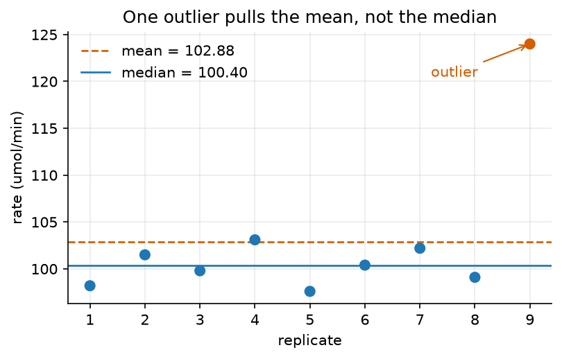
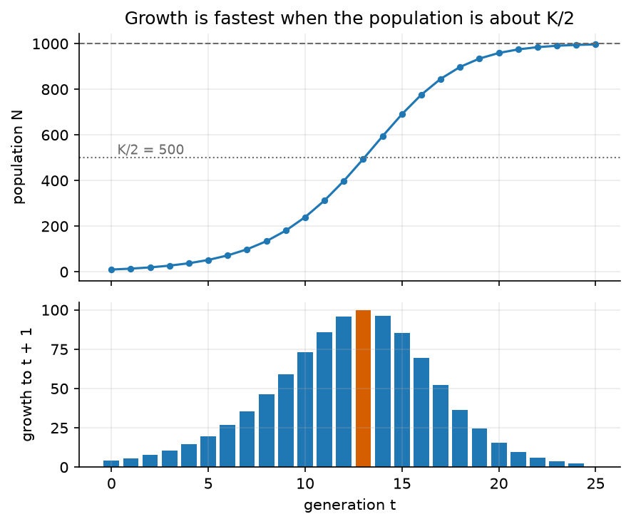

# Handout 4: Vectors and Strings

**Session length:** about 60 minutes. **Prerequisite:** [Handout 3](03-functions.md).

So far a value had its own variable, and a list of values was a fixed array with a separate count. Real data come in rows: replicate measurements, DNA sequences, a maze, predictions for hundreds of samples. This handout introduces the two containers that hold such data in everyday C++: `std::vector` (a row of values that can grow) and `std::string` (a row of characters).

After this session you can:

- store, read and change a series of values in a `std::vector`,
- loop over a vector or a string with range-`for`,
- pass vectors to functions the right way,
- compute basic statistics, analyse a DNA sequence, and store the history of a simulation,
- represent a table (a maze) as a vector of vectors,
- count true and false positives and negatives, and explain why accuracy alone can mislead.

All programs are in [`examples/04-vectors`](../examples/04-vectors). Their build targets are named `04_<program>`.

---

## 1. The quick tour

All snippets of this section are in [`tour.cpp`](../examples/04-vectors/tour.cpp). It needs `#include <vector>` and `#include <string>`.

### 1.1 `std::vector`: a row of values that can grow

```cpp
std::vector<double> temperatures = {36.6, 37.1, 38.4};
temperatures.push_back(36.9);            // append at the end
temperatures.size();                     // 4
temperatures[0];                         // 36.6, the first element (counting from 0)
temperatures.back();                     // 36.9, the last element

std::vector<int> zeros(5, 0);            // five elements, all 0
```

- **Idea:** a vector is like the array of handout 2, but it **knows its own size** and can **grow**. The type of the elements goes in angle brackets: `std::vector<double>`. You can start empty and use `push_back`, start with a list of values, or start with `n` copies of a value.
- **Trouble:** a vector is not an array: it is an object with its own functions (`push_back`, `size`), and elements are added at the end only. One special case: `std::vector<bool>` is implemented differently from all other vectors and behaves oddly (its elements are not real variables), so a list of yes/no flags is better stored as `std::vector<int>`.
- **In practice:** use `std::vector` instead of arrays almost everywhere. Create it empty and `push_back` when you do not know the size in advance. If you know the size, give it at once (`std::vector<int> counts(5, 0)`), which is both clear and fast.

### 1.2 Range-`for`: visit every element

```cpp
double sum = 0.0;
for (double t : temperatures) {      // t is a COPY of each element
    sum += t;
}

for (double& t : temperatures) {     // t IS the element: changing t changes the vector
    t -= 36.6;
}
```

- **Idea:** `for (type name : container)` runs the body once for every element, with no index and no off-by-one error.
- **Trouble:** without the `&` the loop variable is a **copy**. A change to it is lost, and for big elements (long strings, vectors of vectors) every round copies the element. Never add or remove elements of the vector you are looping over: that is undefined behavior.
- **In practice:** use `for (double x : v)` to read small values, `for (double& x : v)` to change them, and `for (const std::string& s : names)` to read big elements without copying. Use a normal index loop only when you need the position, or the neighbors.

### 1.3 Indexing, `size()` and `at()`

```cpp
temperatures[2];        // no check: outside the vector it is undefined behavior
temperatures.at(10);    // checked: throws std::out_of_range
```

Output of `tour.cpp` (the first part):

```text
size: 4, first: 36.6, last: 36.9
zeros has 5 elements
sum = 149
differences: 0 0.5 1.8 0.3
at(10) failed: vector::_M_range_check: __n (which is 10) >= this->size() (which is 4)
empty.size() - 1 = 18446744073709551615
```

- **Idea:** `v[i]` reads element `i`, counting from 0. `v.at(i)` does the same but **checks** the index and raises an error that stops the program (or that you can catch) instead of reading garbage.
- **Trouble:** `v[i]` has no [bounds checking](../notes/glossary.md#bounds-checking). And `v.size()` is an **unsigned** number (type `std::size_t`). Subtracting from it can wrap around: for an empty vector, `v.size() - 1` is not `-1` but the largest possible unsigned number (18446744073709551615 on a 64-bit system). A loop `for (i = 0; i <= v.size() - 1; ++i)` over an empty vector then runs far past the end of the vector (see [overflow](../notes/glossary.md#overflow)). Comparing an `int` with `size()` can also give compiler warnings about *signed and unsigned*.
- **In practice:** loop with `std::size_t i = 0; i < v.size(); ++i`, and write conditions as `i + 1 < v.size()` instead of `i < v.size() - 1`. Use `at()` while you are developing and testing, and `[]` when the code is correct and speed matters. The text of the `at()` error message depends on the compiler: Microsoft's says `invalid vector subscript`, GCC's prints the numbers as above.

### 1.4 Vectors and functions

```cpp
double mean(const std::vector<double>& values);   // only reads: const reference
double median(std::vector<double> values);        // works on a deliberate COPY
std::vector<double> moving_average(const std::vector<double>& values, std::size_t window);  // returns a vector
```

- **Idea:** the rules of handout 3 apply: read-only big objects are passed by `const` reference, and a function may simply **return** a vector.
- **Trouble:** passing a vector by value copies **all** its elements at every call. That is only right when you really want a copy, as in `median` below, which sorts its parameter and must not reorder the caller's data. Passing by non-`const` reference lets the function change the caller's vector, which a reader of the call cannot see.
- **In practice:** `const std::vector<double>&` is the default for inputs. Return a vector by value (this is cheap in modern C++). Choose pass-by-value only when the function needs its own modifiable copy, and write a comment saying so.

### 1.5 `std::string`: a row of characters

```cpp
std::string seq = "ATGGCC";
seq += "TAA";                     // append: "ATGGCCTAA"
seq.length();                     // 9
seq[0];                           // 'A' (a char)
seq.substr(0, 3);                 // "ATG": 3 characters starting at position 0
seq.find("GCC");                  // 3: position of the first match
seq.find("XYZ") == std::string::npos   // true: not found
seq == "ATGGCCTAA";               // true: strings compare by content
```

```text
seq = ATGGCCTAA, length 9, first character A
first codon: ATG
GCC starts at position 3
XYZ not found
seq == "ATGGCCTAA": 1
```

- **Idea:** a `std::string` behaves like a `vector<char>` with text-friendly extras: `+` and `+=` to join, `==` to compare, `find` and `substr` to search and cut. You can loop over it with range-`for`, and `s[i]` is a single `char`.
- **Trouble:** `'A'` (single quotes) is one character, `"A"` (double quotes) is a text. `find` returns a **position**, and when there is no match it returns the special value `std::string::npos`, a huge unsigned number that is easy to use by mistake as a position ([sentinel value](../notes/glossary.md#sentinel-value)). Always compare with `npos` before you use the result.
- **In practice:** use `std::string` for all text, including DNA sequences and file names. Pass it by `const std::string&` into functions. Positions count from 0.

### 1.6 A vector of vectors: a table

```cpp
std::vector<std::vector<int>> table(3, std::vector<int>(4, 0));   // 3 rows, 4 columns, all 0
table[1][2] = 7;                                                   // row 1, column 2
```

```text
0 0 0 0 
0 0 7 0 
0 0 0 0 
```

- **Idea:** the elements of a vector can themselves be vectors. `table[r][c]` is column `c` of row `r`.
- **Trouble:** `[row][column]`, in that order, is a convention that you must keep consistently. Mixing it up gives a transposed table without an error message. The `> >` problem of old C++ (a space was needed between the brackets) no longer exists. Rows can have different lengths, so `table[0].size()` is the length of one row, not of the whole table.
- **In practice:** use it for grids, images and matrices of moderate size. Name the dimensions (`rows`, `cols`) and loop `for (r ...) for (c ...)`.

---

## 2. Core example: statistics of repeated measurements

### The problem

An enzyme assay was repeated nine times. What is the typical rate, and how much do the replicates scatter? One replicate looks suspicious.

### Background

For $n$ values $x_1, \dots, x_n$:

$$\bar{x} = \frac{1}{n}\sum_{i=1}^{n} x_i \qquad\qquad s = \sqrt{\frac{1}{n-1}\sum_{i=1}^{n}\left(x_i - \bar{x}\right)^2}$$

- The **mean** $\bar{x}$ is the average.
- The **sample standard deviation** $s$ measures the scatter. It divides by $n-1$, not $n$, because the mean was estimated from the same data, which makes the deviations a little too small.
- The **median** is the middle value of the sorted data (the average of the two middle values if $n$ is even). Half of the values are smaller, half larger.

The standard deviation is computed in **two passes**: first the mean, then the sum of squared deviations from it. The one-pass shortcut ($\sum x^2 - n\bar{x}^2$) can lose all its precision when the values are large and close together, because it subtracts two nearly equal numbers (see [floating-point number](../notes/glossary.md#floating-point-number)).

### The program

[`statistics.cpp`](../examples/04-vectors/statistics.cpp). The data are hypothetical: enzyme rates in µmol/min.

```cpp
double mean(const std::vector<double>& values)
{
    double sum = 0.0;
    for (double v : values) {
        sum += v;
    }
    return sum / static_cast<double>(values.size());
}

// Sample standard deviation (divide by n - 1). Two passes: first the mean, then the squared deviations.
double standard_deviation(const std::vector<double>& values)
{
    const double m = mean(values);
    double sum_of_squares = 0.0;
    for (double v : values) {
        sum_of_squares += (v - m) * (v - m);
    }
    return std::sqrt(sum_of_squares / static_cast<double>(values.size() - 1));
}

// The parameter is a COPY (not a reference) on purpose: sorting must not reorder the caller's data.
double median(std::vector<double> values)
{
    std::sort(values.begin(), values.end());
    const std::size_t n = values.size();
    if (n % 2 == 1) {
        return values[n / 2];
    }
    return 0.5 * (values[n / 2 - 1] + values[n / 2]);
}
```

`main` holds `{98.2, 101.5, 99.8, 103.1, 97.6, 100.4, 102.2, 99.1, 124.0}`, prints the statistics, copies the values below 110 into a second vector and prints them again:

```text
Data (9 values): 98.20 101.50 99.80 103.10 97.60 100.40 102.20 99.10 124.00
All values:       n = 9   mean = 102.88   SD = 8.13   median = 100.40
Without outlier:  n = 8   mean = 100.24   SD = 1.94   median = 100.10
```



I checked these numbers with an independent calculation (NumPy: `mean`, `std(ddof=1)`, `median`), and they agree.

### Walkthrough

1. The three functions take the data as `const std::vector<double>&`. Only `median` takes a **copy**, deliberately (section 1.4).
2. `std::sort` (from `<algorithm>`) puts the copy in order. Handout 6 explains the algorithms library. Here you only need to know that `values.begin(), values.end()` means "the whole vector".
3. `n / 2` is an **integer division** (section 1.2 of handout 2): for $n = 9$ it is 4, the index of the middle element of 9 (counting from 0). For even $n$, the two middle elements are `n/2 - 1` and `n/2`.
4. `values.size() - 1` in the standard deviation is safe here, because we divide by it only for $n \ge 2$. For an **empty** vector it would wrap around to a huge number (section 1.3), and for a single value it would be zero (division by zero). A careful version checks `values.size() < 2` first.
5. **The outlier:** one value (124.0) moves the mean from 100.24 to 102.88 and the standard deviation from 1.94 to 8.13 (more than four times larger), but the median only from 100.10 to 100.40. The median is **robust**, the mean and SD are not.
6. A word of caution: removing a data point because it spoils the result is not acceptable in science. An outlier may be an error (a pipetting mistake, a typo) or the most interesting measurement of the series. The example shows the numerical effect, not a rule for deleting data.

---

## 3. Core example: GC content of a DNA sequence

### The problem

How much of a DNA sequence consists of the bases G and C?

### Background

The **GC content** is the fraction of G and C among all bases:

$$\mathrm{GC} = \frac{n_G + n_C}{n_A + n_C + n_G + n_T}$$

It matters because a G-C pair has three hydrogen bonds and an A-T pair only two, so GC-rich DNA melts at a higher temperature, and the GC content differs between organisms and genome regions. Sequencers sometimes report a base as unknown (`N`). These are left out of the denominator.

### The program

[`gc_content.cpp`](../examples/04-vectors/gc_content.cpp). The sequence is invented for the example and contains two `N`.

```cpp
int count_base(const std::string& dna, char base)
{
    int count = 0;
    for (char c : dna) {
        if (c == base) {
            ++count;
        }
    }
    return count;
}

// Fraction of G or C among the bases A, C, G and T (other characters, such as N, are ignored).
double gc_content(const std::string& dna)
{
    const int a = count_base(dna, 'A');
    const int c = count_base(dna, 'C');
    const int g = count_base(dna, 'G');
    const int t = count_base(dna, 'T');
    const int known = a + c + g + t;
    if (known == 0) {
        return 0.0;
    }
    return static_cast<double>(g + c) / known;
}
```

Output:

```text
Sequence length: 54
  A: 12
  C: 13
  G: 15
  T: 12
  N:  2
GC content: 53.8 %
```

### Walkthrough

1. A string is looped over with range-`for` exactly like a vector, and the loop variable `c` is a `char` (a single character).
2. Characters are compared with `==` and **single quotes**: `c == 'A'`. Writing `"A"` would compare a character with a text and not compile.
3. `static_cast<double>(g + c) / known` avoids [integer division](../notes/glossary.md#integer-division). Without the cast, `(g + c) / known` would be 0 or 1.
4. The check `known == 0` protects against dividing by zero for an empty sequence, or one made only of `N`.
5. The result matches the hand count: $(13 + 15) / (12 + 13 + 15 + 12) = 28/52 = 53.8\,\%$. I also confirmed the counts independently with a short Python script.
6. Only upper-case letters are counted. A lower-case `a` (some tools use it for "soft-masked" regions) is ignored. A real tool would convert the case first.

---

## 4. Core example: keeping the history of a simulation

### The problem

Handout 3 turned the logistic update into a function. But the simulation printed numbers and forgot them. When is the population above 90 % of the capacity? When does it grow fastest? Such questions need the **whole history**.

### The program

[`logistic_v3.cpp`](../examples/04-vectors/logistic_v3.cpp): version 3 of the **simulation thread**. The model and `logistic_step` are unchanged. What is new is that the results are stored.

```cpp
std::vector<double> population;
population.push_back(10.0);
for (int t = 0; t < generations; ++t) {
    population.push_back(logistic_step(population.back(), r, capacity));
}

std::vector<double> growth;       // growth[t] = increase from generation t to t + 1
for (std::size_t t = 0; t + 1 < population.size(); ++t) {
    growth.push_back(population[t + 1] - population[t]);
}
```

After the table, two loops over the stored vectors answer the questions. Output:

```text
  gen  population    growth
    0        10.0       4.0
    1        14.0       5.5
    2        19.5       7.6
    3        27.1      10.5
    4        37.6      14.5
    5        52.1      19.8
    6        71.9      26.7
    7        98.6      35.6
    8       134.2      46.5
    9       180.6      59.2
   10       239.8      72.9
   11       312.7      86.0
   12       398.7      95.9
   13       494.6     100.0
   14       594.6      96.4
   15       691.0      85.4
   16       776.4      69.4
   17       845.9      52.2
   18       898.0      36.6
   19       934.6      24.4
   20       959.1      15.7
   21       974.8       9.8
   22       984.6       6.1
   23       990.7       3.7
   24       994.4       2.2
   25       996.6         -

First generation with N >= 90 % of K: 19
Largest growth per generation: 100.0 (generation 13 to 14, starting at N = 494.6)
```



### Walkthrough

1. The population values are the same as in handouts 2 and 3. Only the bookkeeping changed.
2. `population.back()` is the most recent value, so the next generation is computed from it. `push_back` appends.
3. The condition `t + 1 < population.size()` is the safe form of section 1.3: it never reads `population[t + 1]` outside the vector and never subtracts from an unsigned number. Because there is one growth value fewer than population values, the last row of the table shows `-`.
4. The result has a simple explanation. The increase per generation is $g(N) = rN\left(1 - N/K\right)$, a parabola in $N$ with its peak at $N = K/2$, where $g = rK/4 = 0.4 \cdot 1000 / 4 = 100$. The program found exactly this: the largest growth, 100.0, starts at $N = 494.6$, close to $K/2$. A simulation that agrees with a calculation you can do by hand builds trust in the program.
5. The independent check: I repeated the calculation in Python, which gave the same generation (19) and the same maximum (100.0 at generation 13).

---

## 5. Core example: a maze as a table

### The problem

A maze is given as text. Where are the start and the goal, how many cells can be walked on, and how do we prepare a table in which a search can later note the distance of every cell from the start?

### The program

[`grid.cpp`](../examples/04-vectors/grid.cpp): version 3 of the **search thread**. Handout 6 will use this table to search the maze.

```cpp
// # = wall, . = free, S = start, G = goal
const std::vector<std::string> maze = {
    "###########",
    "#S..#.....#",
    "#.#.#.###.#",
    "#.#...#...#",
    "#.#####.#G#",
    "#.......#.#",
    "###########",
};
const std::size_t rows = maze.size();
const std::size_t cols = maze[0].size();
```

A maze is a **vector of strings**: each string is a row, and `maze[r][c]` is the cell in row `r`, column `c`. The program finds the `S` and `G` with `find`, counts the cells, and creates a second table of the same shape:

```cpp
// -1 means "not reached yet"
std::vector<std::vector<int>> distance(rows, std::vector<int>(cols, -1));
distance[start_row][start_col] = 0;
```

Output:

```text
Maze: 7 rows, 11 columns
Start at (1, 1), goal at (4, 9)
Walls: 47, free cells (including S and G): 30

Distance table (### wall, . not reached yet, number = steps from the start):
#################################
###  0  .  .###  .  .  .  .  .###
###  .###  .###  .#########  .###
###  .###  .  .  .###  .  .  .###
###  .###############  .###  .###
###  .  .  .  .  .  .  .###  .###
#################################
```

### Walkthrough

1. `maze[r].find('S')` searches one row. It returns the column, or `std::string::npos` if the row has no `S`. The program tests for `npos` before using the result (section 1.5).
2. The range-`for` over `maze[r]` counts walls and free cells. The total is 47 + 30 = 77, which equals 7 rows × 11 columns, as it should.
3. `std::vector<std::vector<int>> distance(rows, std::vector<int>(cols, -1))` reads from the inside: a row is `cols` integers equal to `-1`, and the table is `rows` such rows. The `-1` is a [sentinel value](../notes/glossary.md#sentinel-value): a real distance is never negative.
4. The two tables are separate on purpose. `maze` never changes, and `distance` is what a search fills in. Row first, column second, in both.
5. The maze is hard-coded here. Handout 5 reads it from a file. Handout 6 fills the distance table with a breadth-first search, and handout 10 searches it with A*.

---

## 6. Core example: counting right and wrong answers

### The problem

A diagnostic test was evaluated on 20 samples. 8 were really sick, 12 healthy. For each sample we know the truth and the prediction. How good is the test?

### Background

Every prediction of a yes/no classifier falls in one of four classes. These are counted in a **confusion matrix**:

| | predicted positive | predicted negative |
|---|---|---|
| **actual positive** | TP (true positive: sick, found) | FN (false negative: sick, missed) |
| **actual negative** | FP (false positive: healthy, flagged) | TN (true negative: healthy, cleared) |

The simplest summary is the **accuracy**, the fraction of correct answers:

$$\text{accuracy} = \frac{TP + TN}{TP + TN + FP + FN}$$

The next handouts add precision, recall and F1, which describe the two kinds of errors separately. Fawcett's paper is a good introduction to evaluating classifiers this way.

### The program

[`confusion_counts.cpp`](../examples/04-vectors/confusion_counts.cpp): version 1 of the **classification thread**. The data are invented. Labels are `1` (positive) and `0` (negative), stored in `std::vector<int>`.

```cpp
void count_confusion(const std::vector<int>& actual, const std::vector<int>& predicted,
                     int& tp, int& tn, int& fp, int& fn)
{
    tp = 0; tn = 0; fp = 0; fn = 0;
    for (std::size_t i = 0; i < actual.size(); ++i) {
        if (actual[i] == 1 && predicted[i] == 1) {
            ++tp;
        } else if (actual[i] == 0 && predicted[i] == 0) {
            ++tn;
        } else if (actual[i] == 0 && predicted[i] == 1) {
            ++fp;
        } else {
            ++fn;
        }
    }
}
```

The program evaluates two cases. The first is the 20 samples, the second is a "classifier" that always answers "healthy" on 100 samples, of which only 5 are sick:

```text
A test on 20 samples:
                  predicted 1   predicted 0
  actual 1               6             2      (TP, FN)
  actual 0               1            11      (FP, TN)
  accuracy = (TP + TN) / all = 0.85

Always answering 'healthy', 100 samples with 5 sick:
                  predicted 1   predicted 0
  actual 1               0             5      (TP, FN)
  actual 0               0            95      (FP, TN)
  accuracy = (TP + TN) / all = 0.95
```

### Walkthrough

1. The two vectors are walked through together by index, so they **must have the same length**. The function does not check it, and a mismatch would read outside the shorter vector. A careful version compares `actual.size()` with `predicted.size()` first.
2. The four **reference parameters** (`int& tp, ...`) are how this function returns four results. It works, but is clumsy: the call hides that four variables change, and the order matters. In handout 9 this becomes a `ConfusionMatrix` class. This is the "before" version.
3. The test on 20 samples found 6 of the 8 sick samples (it missed 2) and wrongly flagged 1 healthy sample. Its accuracy is $(6+11)/20 = 0.85$.
4. **The trap:** the second classifier has an accuracy of **0.95**, which looks better than the real test, yet it is useless. It finds none of the 5 sick samples. When one class is rare, the accuracy mostly measures how big the common class is. That is why the confusion matrix, and the measures of the next handouts, look at both kinds of errors.
5. The rare-case labels are built with `std::vector<int> actual_rare(100, 0)`, the "n copies of a value" form of section 1.1, followed by a loop that sets five entries to 1.

---

## 7. Same problem, new tool

### The element table of handout 1

In handout 1 the table of five elements was printed by five nearly identical blocks of `std::cout` statements. With vectors the data are separated from the printing. [`element_table_v2.cpp`](../examples/04-vectors/element_table_v2.cpp):

```cpp
const std::vector<int> numbers = {1, 6, 7, 8, 15};
const std::vector<std::string> symbols = {"H", "C", "N", "O", "P"};
const std::vector<std::string> names = {"Hydrogen", "Carbon", "Nitrogen", "Oxygen", "Phosphorus"};
const std::vector<double> masses = {1.008, 12.011, 14.007, 15.999, 30.974};

std::cout << std::fixed << std::setprecision(3);
for (std::size_t i = 0; i < numbers.size(); ++i) {
    std::cout << std::left << std::setw(4) << numbers[i] << std::setw(8) << symbols[i] << std::setw(12)
              << names[i] << std::right << std::setw(8) << masses[i] << '\n';
}
```

The output is **identical, line by line,** to that of `element_table.cpp` (I compared both programs). Adding a sixth element now means adding one entry to each vector, with no new printing code.

The new version has a weakness: four **parallel vectors** must stay in step. Entry 3 of all four vectors is oxygen, and the water calculation relies on hydrogen being entry 0 and oxygen entry 3 (`masses[0]`, `masses[3]`). Add a vector entry in the wrong place of one vector, and every later element is silently wrong. The cure, one record per element, comes with `struct` in handout 6 and with classes in handout 9.

### The three threads

| Thread | Handout 3 | Now (handout 4) | Next |
|---|---|---|---|
| Simulation | `logistic_step`, `population_after` | the whole history in a `vector`, analysed afterwards | handout 5: write it to a CSV file for plotting |
| Search | arrays, `linear_find`, `binary_find` | the maze as `vector<string>`, a distance table as `vector<vector<int>>` | handout 5: read the maze from a file, handout 6: breadth-first search |
| Classification | not started | counting TP, TN, FP, FN and the accuracy | handout 5: read predictions from a file, add precision, recall, F1 |

---

## 8. Extra examples

Pick what interests you. Each is a complete program in `examples/04-vectors`, and its results were checked independently.

### 8.1 Reverse complement: [`reverse_complement.cpp`](../examples/04-vectors/reverse_complement.cpp)

The second strand of DNA is the **complement** of the first (A-T, C-G), read in the opposite direction. The reverse complement is used when you look for a gene on the other strand.

```cpp
std::string reverse_complement(const std::string& dna)
{
    std::string result;
    // Counting down with an unsigned index: i runs from size to 1, and we use dna[i - 1].
    for (std::size_t i = dna.size(); i > 0; --i) {
        result.push_back(complement(dna[i - 1]));
    }
    return result;
}
```

```text
sequence:           5'-ATGCGTAACG-3'
reverse complement: 5'-CGTTACGCAT-3'

GAATTC -> GAATTC  (palindromic: reads the same on both strands)
```

**What to notice**

- The loop counts **down** with an unsigned index. `i >= 0` would be always true for an unsigned number, so the loop runs from `size` to 1 and uses `dna[i - 1]`. This is the standard remedy for the wrap-around of section 1.3.
- `push_back` builds the result one character at a time.
- The site `GAATTC` (the recognition site of the restriction enzyme EcoRI) equals its own reverse complement. Such sequences are called **palindromic**, in the molecular sense.

### 8.2 Restriction sites: [`restriction_sites.cpp`](../examples/04-vectors/restriction_sites.cpp)

Restriction enzymes cut DNA at short, specific sequences. Where are the sites of EcoRI (`GAATTC`), BamHI (`GGATCC`) and HindIII (`AAGCTT`) in a sequence? The sequence here is invented. The recognition sequences are the standard textbook ones, listed in the REBASE database.

```cpp
std::vector<std::size_t> find_all(const std::string& text, const std::string& pattern)
{
    std::vector<std::size_t> positions;
    std::size_t pos = text.find(pattern);
    while (pos != std::string::npos) {
        positions.push_back(pos);
        pos = text.find(pattern, pos + 1); // continue just after the previous hit
    }
    return positions;
}
```

```text
Sequence (42 bases): CCGAATTCTTAGGATCCAAGCTTGGAATTCAATTGGATCCGA

EcoRI (GAATTC), palindromic: 2 site(s) at position 3 at position 25
BamHI (GGATCC), palindromic: 2 site(s) at position 12 at position 35
HindIII (AAGCTT), palindromic: 1 site(s) at position 18
```

**What to notice**

- `find(pattern, start)` searches from a given position, so a `while` loop finds all hits. Starting each search at `pos + 1` also finds **overlapping** hits.
- The function returns a `std::vector<std::size_t>`: any number of positions, no need to know the count in advance.
- `find` counts from 0, and the program prints `h + 1`, because sequence viewers count from 1. Decide on one convention and say it in a comment: this is a common off-by-one source.
- A palindromic site is cut on both strands at the same place, so one search covers both strands. For a non-palindromic site you would also have to search for its reverse complement.

### 8.3 Moving average: [`moving_average.cpp`](../examples/04-vectors/moving_average.cpp)

Noisy measurements are often smoothed by averaging neighboring values. With a window of 3, each result is the mean of three consecutive values.

```text
raw (10 values):       2.10  2.90  2.40  3.60  3.10  4.40  3.80  5.20  4.90  5.50
smoothed (8 values):   2.47  2.97  3.03  3.70  3.77  4.47  4.63  5.20
```

**What to notice**

- The smoothed series is **shorter**: $n - w + 1$ values for $n$ values and window $w$ (here $10 - 3 + 1 = 8$). The edges have no complete window. Real tools handle them in different ways, so decide and document.
- The loop condition `start + window <= values.size()` adds instead of subtracting, to stay safe with unsigned numbers (section 1.3).
- If the window is 0 or longer than the data, the function returns an **empty vector** instead of failing. The caller must be prepared for that.
- Averaging smooths noise, but also flattens real peaks: compare the raw maximum of 5.50 with the smoothed 5.20.

### 8.4 A text histogram: [`text_histogram.cpp`](../examples/04-vectors/text_histogram.cpp)

How are 24 mouse body masses distributed? The program counts how many fall into each 2 g wide bin and draws a bar for each.

```text
 20 - 22 g | * 1
 22 - 24 g | ***** 5
 24 - 26 g | ********* 9
 26 - 28 g | ****** 6
 28 - 30 g | *** 3
```

**What to notice**

- The bin of a value is `static_cast<std::size_t>((m - low) / width)`: subtract the lower edge, divide by the bin width, drop the decimals. This is a case where cutting off decimals is exactly what you want.
- `std::vector<int> counts(bins, 0)` is a vector of counters, and `++counts[bin]` counts one more value in that bin.
- `std::string(n, '*')` builds a text of `n` stars: the bar.
- The two checks (`m >= low` and `bin < bins`) ignore values outside the range. Without the second one, a mass of 31 g would write outside the vector. Without the first one, a value below the range would give a negative number, and converting a negative `double` to an unsigned type is not defined.

### 8.5 Pearson correlation: [`correlation.cpp`](../examples/04-vectors/correlation.cpp)

How strongly are two series related in a straight-line way? The **Pearson correlation coefficient** is

$$r = \frac{\sum_i (x_i - \bar{x})(y_i - \bar{y})}{\sqrt{\sum_i (x_i - \bar{x})^2 \; \sum_i (y_i - \bar{y})^2}}$$

It lies between $-1$ (perfect falling line) and $+1$ (perfect rising line), and is near 0 if there is no linear relation.

```text
dose vs response:        r = 0.991
dose vs 20 - response:   r = -0.991
dose vs unrelated noise: r = 0.105
```

**What to notice**

- Turning the response upside down (`20 - response`) flips the sign of $r$ but not its size. The correlation measures the strength **and direction** of a linear relation.
- The function takes two vectors by `const` reference and walks through both by one index. It assumes equal lengths and does not check it (section 6).
- The numbers agree with NumPy's `corrcoef`.
- A high $r$ does not prove that one quantity causes the other, and it says nothing about relations that are not straight lines. Always plot the data too.

---

## 9. Summary

- `std::vector` is the everyday container: it knows its size, grows with `push_back`, and is passed to functions by `const` reference. `std::string` is a vector of characters with text tools (`+`, `==`, `find`, `substr`).
- Range-`for` visits every element: `for (double x : v)` reads, `for (double& x : v)` changes.
- `v[i]` is not checked, `v.at(i)` is. `size()` is unsigned, so write `i + 1 < v.size()` instead of `i < v.size() - 1`, and count down with `i > 0` and `v[i - 1]`.
- `find` returns `std::string::npos` when nothing matches. Test it before using the result.
- A table is a vector of vectors (`table[row][column]`) or a vector of strings.
- The median is robust against outliers, the mean and the standard deviation are not. Never delete data just because it spoils the result.
- Accuracy alone can mislead when one class is rare. Count TP, TN, FP and FN.
- Keeping data in vectors separates data from code. Parallel vectors are a first step, and records (`struct`, later classes) are the next.

## References

All addresses and DOIs were checked on 2026-11-22. The numerical results of the examples were also checked with independent calculations (NumPy and plain Python).

1. W. H. Press, S. A. Teukolsky, W. T. Vetterling, B. P. Flannery, *Numerical Recipes: The Art of Scientific Computing*, 3rd ed., Cambridge University Press, 2007. ISBN 978-0-521-88068-8. Chapter 14, "Statistical Description of Data" (mean, variance, median, linear correlation).
2. T. Fawcett, "An introduction to ROC analysis", *Pattern Recognition Letters* **27**, 861-874 (2006). doi:[10.1016/j.patrec.2005.10.010](https://doi.org/10.1016/j.patrec.2005.10.010)
3. R. J. Roberts, T. Vincze, J. Posfai, D. Macelis, "REBASE: a database for DNA restriction and modification: enzymes, genes and genomes", *Nucleic Acids Research* **43**, D298-D299 (2015). doi:[10.1093/nar/gku1046](https://doi.org/10.1093/nar/gku1046). Database: <http://rebase.neb.com/rebase/rebase.html>
4. B. Stroustrup, *A Tour of C++*, 3rd ed., Addison-Wesley, 2022. <https://www.stroustrup.com/tour3.html>
5. cppreference.com: [`std::vector`](https://en.cppreference.com/w/cpp/container/vector), [`vector::at`](https://en.cppreference.com/w/cpp/container/vector/at), [`std::vector<bool>`](https://en.cppreference.com/w/cpp/container/vector_bool), [`std::string`](https://en.cppreference.com/w/cpp/string/basic_string), [`string::find`](https://en.cppreference.com/w/cpp/string/basic_string/find), [range-based `for`](https://en.cppreference.com/w/cpp/language/range-for), [`std::size_t`](https://en.cppreference.com/w/cpp/types/size_t), [`std::sort`](https://en.cppreference.com/w/cpp/algorithm/sort).
