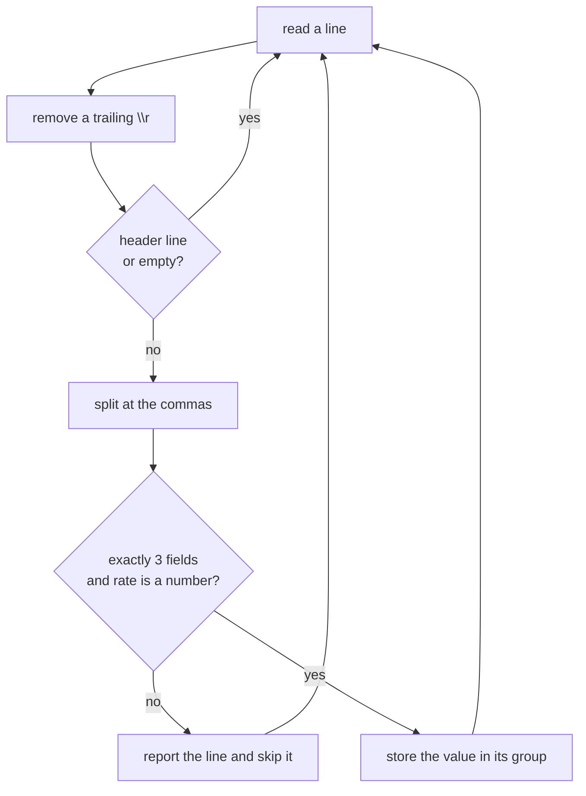
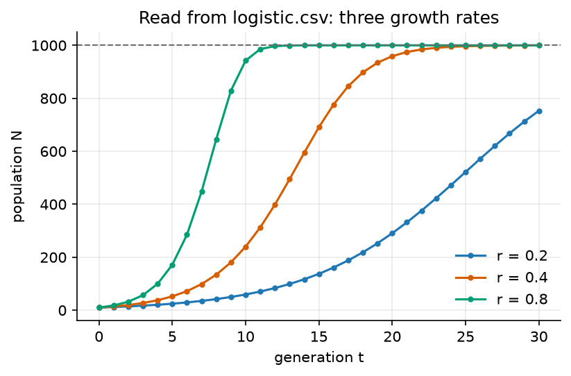

# Handout 5: Files

**Session length:** about 60 minutes. **Prerequisite:** [Handout 4](04-vectors.md).

Until now the data were typed into the program, and the results disappeared from the console. Real work starts with files: measurements from an instrument, sequences from a database, results that a plotting tool or a colleague has to read. This handout shows how to read and write text files, how to take a line apart, and how to cope with messy data.

After this session you can:

- write results to a file and read a file line by line,
- split a CSV line into fields and convert text into numbers safely,
- detect and report bad input instead of silently using it,
- read a maze, a table of classifier scores, a FASTA file, a log file and a parameter file,
- compute precision, recall, specificity and F1 from a file of predictions.

All programs are in [`examples/05-files`](../examples/05-files). Their build targets are named `05_<program>`. The input files are in the [`data`](../data) folder.

---

## 0. Where are the files? (read this first)

A program that opens `"maze.txt"` looks for it in its **current working directory**. That is the folder the program was started from, and it depends on the IDE and on how you start the program. The same program works from one place and says "cannot open" from another. This is the most common problem with files, so the examples avoid it:

- CMake tells every example two folder names while compiling: `DATA_DIR` (the `data` folder of the repository, where the input files are) and `OUTPUT_DIR` (the folder `output` inside the build folder, where result files are written). The programs use them as `std::string(DATA_DIR) + "/maze.txt"`.
- If you compile an example **by hand** with `g++`, these names are not defined, and the programs fall back to `data` and `.` (the current folder). Then run the program **from the repository root**.
- The programs never print these full paths, so their output does not depend on where your repository is.

Forward slashes (`/`) work in file paths on Windows as well, and they avoid the problem that a backslash in a C++ text means something special (`"\n"` is a newline, not the folder `n`).

---

## 1. The quick tour

All snippets of this section are in [`tour.cpp`](../examples/05-files/tour.cpp). It needs `#include <fstream>` (files), `<sstream>` (text as a stream) and `<string>`.

### 1.1 Writing a file

```cpp
{
    std::ofstream out(path);
    if (!out) {
        std::cerr << "Cannot write demo.txt\n";
        return 1;
    }
    out << "sample,value\n";
    out << "A,1.5\n";
    out << "B,2.25\n";
} // the file is closed here, when `out` goes out of scope
```

- **Idea:** an `std::ofstream` ("output file stream") is used exactly like `std::cout`: `<<` sends text into it, and `std::fixed`, `std::setprecision` and `std::setw` work the same way. The file is closed automatically at the end of the block in which the variable lives.
- **Trouble:** opening a file **for writing erases it** if it already exists, without any question (I tested it: after opening an existing file for writing, 0 lines were left). The opening can also fail: the folder does not exist, you have no right to write there, or another program holds the file (Excel often locks a CSV file that it has open). In all these cases the stream silently goes into an error state, and later `<<` do nothing.
- **In practice:** always test `if (!out)` right after opening, and say **which** file failed. Write results to a separate output folder, never into the folder of your original data. To append to a file instead of erasing it, open it with `std::ofstream out(path, std::ios::app)`.

### 1.2 Reading line by line

```cpp
std::ifstream in(path);
if (!in) { /* report the problem */ }

std::string line;
int number = 0;
while (std::getline(in, line)) { // false at the end of the file
    ++number;
    std::cout << "line " << number << ": " << line << '\n';
}
```

```text
line 1: sample,value
line 2: A,1.5
line 3: B,2.25
no_such_file.txt: cannot open
```

- **Idea:** `std::ifstream` reads like `std::cin`. `std::getline(in, line)` reads one line into `line` (without the end-of-line character) and gives back the stream, which is `false` as soon as nothing could be read. That is why it works directly as a loop condition.
- **Trouble:** the textbook-looking loop `while (!in.eof())` is **wrong**. The end of the file is only noticed after a read has failed, so the body runs once too often. I tested it on a file with three lines: the loop ran four times, and the fourth line was empty. A second trap is line endings. A file made on Windows ends lines with the two characters `\r\n`. Windows removes the `\r` for you (my test: first line has length 1 in text mode), but when the same file is read without this conversion it stays at the end of every line (length 2 in binary mode). Then `"98.2\r"` is not a number for the program.
- **In practice:** write `while (std::getline(in, line))`, and remove a trailing `'\r'` from every line (the examples do: `if (!line.empty() && line.back() == '\r') line.pop_back();`). Skip the header line and empty lines explicitly.

### 1.3 When something goes wrong

```cpp
std::ifstream missing(std::string(DATA_DIR) + "/no_such_file.txt");
if (!missing) {
    std::cout << "no_such_file.txt: cannot open\n";
}
```

- **Idea:** a stream carries a state. After a failed opening or a failed read, `!stream` (or `stream.fail()`) is true. This is the same mechanism as in handout 1, where `std::cin >> a` failed on `abc`.
- **Trouble:** nothing stops the program. If you ignore the state and carry on, you read nothing, compute with an empty vector and get silent nonsense (a mean of 0 divided by 0 is NaN, see the glossary entry [NaN and infinity](../notes/glossary.md#nan-and-infinity)). The most frequent cause is a wrong path or a wrong working directory (section 0).
- **In practice:** check every opening, and check every conversion of text into a number (section 1.5). Print the **file name**, the **line number** and the **bad text**. Return an error code from `main` (`return 1;`) when the program cannot continue, so a script that runs the program notices the failure.

### 1.4 Cutting a line into fields

```cpp
std::vector<std::string> split(const std::string& line, char delimiter)
{
    std::vector<std::string> fields;
    std::istringstream stream(line); // a string that can be read like a file
    std::string field;
    while (std::getline(stream, field, delimiter)) {
        fields.push_back(field);
    }
    return fields;
}
```

```text
"S01,control,98.2" -> 3 fields: [S01] [control] [98.2]
"a,,c" -> 3 fields: [a] [] [c]
"a,b," -> 2 fields: [a] [b]
```

- **Idea:** an `std::istringstream` makes a string behave like a file, and `std::getline(stream, field, ',')` reads up to the next comma. Repeating it cuts the line into fields.
- **Trouble:** this method has holes. (1) An empty field in the **middle** is kept (`a,,c` has three fields), but an empty field at the **end** vanishes (`a,b,` gives only two). (2) It knows nothing about **quotes**: `"Smith, J",5` is cut into three fields. (3) Spreadsheets in some countries, **including Hungary**, save "CSV" files with a **semicolon** as separator and a **decimal comma** (`98,4`). Such a number is cut into two fields by a comma-split. A semicolon file is not split at all by a comma-split.
- **In practice:** always **check the number of fields** you expect, and refuse lines with another number. Look at the file in a plain text editor before you write the reader, to see the separator and the decimal mark. For files with quotes or other complications, use a CSV library instead of writing your own splitter. Whoever creates the file can often choose the format. Ask for a comma and decimal points.

### 1.5 From text to numbers

```cpp
bool parse_double(const std::string& text, double& value)
{
    std::istringstream stream(text);
    stream >> value;
    if (stream.fail()) {
        return false;
    }
    stream >> std::ws;   // skip white space after the number
    return stream.eof(); // true only if the whole text was used
}
```

```text
"98.2" -> 98.2
"1e3" -> 1000
"  7 " -> 7
"12abc" -> rejected
"98,2" -> rejected
"" -> rejected
```

- **Idea:** `stream >> value` converts the beginning of the text into a number, and the stream state tells whether this worked. The function returns `true` if the conversion worked **and** the whole text was used.
- **Trouble:** the check of the stream state alone is not enough. `>>` happily reads `12` out of `12abc` and `98` out of `98,2`, and reports success. The leftover text is the sign of a problem. Alternatives such as `std::stod` stop with an **exception** on text that is not a number, which a beginner program does not handle.
- **In practice:** accept a number only if the **whole** field was used, as above. Keep the function small and put it at the top of every program that reads data. It is a `bool` so that the caller can decide what to do with a bad value: skip the line, stop, or report.

---

## 2. Core example: reading messy measurements

### The problem

Real data files are not clean. A CSV file with 12 measurements has an empty value, the text `n/a`, and a number written with a decimal comma. How does a program read it without silently using wrong values, and what does it report?

### Background

A **CSV** file ("comma-separated values") has one record per line, fields separated by commas, often with a header line that names the columns. There is no single official standard, but [RFC 4180](https://www.rfc-editor.org/rfc/rfc4180) describes the common form. The file [`data/measurements.csv`](../data/measurements.csv) (hypothetical enzyme rates) looks like this:

```text
sample,group,rate
S01,control,98.2
...
S07,treated,
S09,treated,n/a
S11,treated,99,4
S12,treated,121.3
```



### The program

[`read_measurements.cpp`](../examples/05-files/read_measurements.cpp) contains `split` and `parse_double` from the tour, and `mean` and `standard_deviation` from handout 4. The core of the reading loop:

```cpp
std::ifstream in(path);
if (!in) {
    std::cerr << "Cannot open " << path << '\n';
    return 1;
}

std::string line;
int line_number = 0;
while (std::getline(in, line)) {
    ++line_number;
    if (!line.empty() && line.back() == '\r') {
        line.pop_back();
    }
    if (line_number == 1 || line.empty()) {
        continue; // header line, empty lines
    }
    ++data_lines;

    const std::vector<std::string> fields = split(line, ',');
    double rate = 0.0;
    // Exactly 3 fields are expected. (A decimal comma, as in "99,4", would create a fourth field.)
    if (fields.size() != 3 || !parse_double(fields[2], rate)) {
        std::cout << "line " << line_number << " skipped: " << line << '\n';
        ++skipped;
        continue;
    }
    // ... store rate in the vector of its group ("control" or "treated") ...
}
```

Output:

```text
line 8 skipped: S07,treated,
line 10 skipped: S09,treated,n/a
line 12 skipped: S11,treated,99,4

Data lines: 12, usable: 9, skipped: 3

control: n = 5   mean = 100.04   SD = 2.29
treated: n = 4   mean = 116.85   SD = 3.93
```

I checked the numbers with an independent calculation in Python (reading the same file with its own code), and they agree.

### Walkthrough

1. Each problem line is reported with its **line number** and its text, and then skipped. The program ends with a summary of how many lines were skipped. A reader of the output can tell immediately whether the result is based on all the data, or only on part of it.
2. **A lesson from writing this example.** My first version tested `fields.size() < 3` instead of `!= 3`. It looked fine, but it accepted line 12: `S11,treated,99,4` is cut into four fields, and the third field is `99`, a perfectly valid number. So the program silently used 99 instead of 99.4. It reported 10 usable lines, and the treated group looked like `n = 5, mean = 113.28, SD = 8.68`, compared with the correct `n = 4, mean = 116.85, SD = 3.93`. Nothing in the output signalled a problem. Checking the **exact** number of fields closed this hole.
3. `S07,treated,` has only two fields (the empty last field vanishes, section 1.4), and `n/a` is not a number. Both are caught by the same `if`.
4. `continue` jumps to the next round of the loop, so the lines that are not usable do not need a deeper nesting of `if` blocks.
5. The standard deviation needs at least two values, and the `print_group` function says so (`too few values`) instead of dividing by zero.
6. Whether the treated group is **significantly** higher than the control is a question for a statistical test, which comes in handout 8. The means and SDs only describe the data.

---

## 3. Core example: writing results for plotting

### The problem

The simulation of handouts 2 to 4 should give its results to a plotting tool, or to a colleague who uses a spreadsheet. A CSV file is the simplest exchange format.

### The program

[`logistic_csv.cpp`](../examples/05-files/logistic_csv.cpp): version 4 of the **simulation thread**. It runs the logistic model for three growth rates and writes one column per rate:

```cpp
std::ofstream out(path);
if (!out) {
    std::cerr << "Cannot write logistic.csv\n";
    return 1;
}
out << std::fixed << std::setprecision(3);
out << "generation,r_0.2,r_0.4,r_0.8\n";

double population[3] = {10.0, 10.0, 10.0};
for (int t = 0; t <= generations; ++t) {
    out << t;
    for (int k = 0; k < 3; ++k) {
        out << ',' << population[k];
        population[k] = logistic_step(population[k], rates[k], capacity);
    }
    out << '\n';
}
out.close(); // make sure everything is written before we read the file again
```

The program then reads the file back and prints its start, as a check:

```text
Wrote 31 data rows to logistic.csv

First lines of the file:
  generation,r_0.2,r_0.4,r_0.8
  0,10.000,10.000,10.000
  1,11.980,13.960,17.920
  2,14.347,19.466,31.999
  3,17.176,27.101,56.779
Lines in the file: 32 (1 header + 31 data rows)
```

The plotting script `figures/make_figures.py` reads **this file** (not the program's console output) and draws:



### Walkthrough

1. The loop is the one from handout 2. The only difference is that `out` is used instead of `std::cout`. Formatting such as `std::fixed` and `std::setprecision(3)` belongs to the **stream**, so the file gets three decimals in every number.
2. The first line is a **header** with the column names. A reader (a person, Excel, Python) uses it to know what the columns mean.
3. Fields are separated by `,` and each row ends with `'\n'`, and **nothing else** is written: no units, no extra spaces, no text in the number columns. Files for other programs should be dull.
4. `out.close()` makes sure that all data have reached the file before the program opens it again for reading. At the end of a block this happens automatically, but here the same function goes on to read the file.
5. The file lands in the `output` folder inside the build folder, so the original data are never touched.
6. The three results show what the growth rate does: at r = 0.8 the population is near the capacity after about 12 generations, at r = 0.4 after about 25, and at r = 0.2 it is still rising after 30.

---

## 4. Core example: the maze from a file

### The problem

The maze of handout 4 was typed into the program. Now it is read from [`data/maze.txt`](../data/maze.txt), so a different maze means a different file, not a new program. A maze file written by hand will sometimes be wrong, so the program must check it.

### The program

[`maze_from_file.cpp`](../examples/05-files/maze_from_file.cpp): version 4 of the **search thread**.

```cpp
// Reads the maze at `path` into `maze`. On failure it returns false and puts a message into `message`.
bool load_maze(const std::string& path, std::vector<std::string>& maze, std::string& message)
{
    std::ifstream in(path);
    if (!in) {
        message = "cannot open the file";
        return false;
    }

    maze.clear();
    std::string line;
    while (std::getline(in, line)) {
        if (!line.empty() && line.back() == '\r') {
            line.pop_back();
        }
        if (line.empty()) {
            continue;
        }
        if (!maze.empty() && line.size() != maze[0].size()) {
            message = "row " + std::to_string(maze.size() + 1) + " has " + std::to_string(line.size()) +
                      " characters, expected " + std::to_string(maze[0].size());
            return false;
        }
        maze.push_back(line);
    }
    // ... also: the file must not be empty, and must contain exactly one S and one G ...
    return true;
}
```

`main` loads the file, prints the maze and its properties, and then tries a file that does not exist:

```text
###########
#S..#.....#
#.#.#.###.#
#.#...#...#
#.#####.#G#
#.......#.#
###########

maze.txt: 7 rows, 11 columns, 47 walls
start (1, 1), goal (4, 9)
maze_missing.txt: cannot open the file
```

### Walkthrough

1. The function returns `true` or `false` and, in case of failure, a **message** through the reference parameter `std::string& message` (handout 3: a second result goes out through a reference). The caller decides what to print.
2. The checks are the questions a careless file would fail: Is the file there? Is it empty? Do all rows have the same length? Is there exactly one start and one goal? Each one has its own message, so the user learns **what** is wrong and **where**.
3. `std::to_string(...)` turns a number into text, so that it can be joined into the message with `+`.
4. The result is exactly the maze of handout 4, now `maze[r][c]` from a file. The search of handout 6 will start from here.
5. The last two lines of `main` show how a missing file is handled: a clear message and no crash.

---

## 5. Core example: classification measures from a file

### The problem

A classifier gives each of 30 samples a **score** between 0 and 1: the higher, the more likely the sample is positive. The file [`data/predictions.csv`](../data/predictions.csv) (invented) has the true label and the score of each sample. A sample counts as predicted positive if its score reaches a **threshold**. How good is the classifier, and how does the threshold change the result?

### Background

Handout 4 counted the four outcomes TP, TN, FP and FN and computed the accuracy. Accuracy can hide problems when one class is rare. Four measures describe the two kinds of errors separately:

$$\text{precision} = \frac{TP}{TP + FP} \qquad \text{recall} = \frac{TP}{TP + FN} \qquad \text{specificity} = \frac{TN}{TN + FP}$$

$$F_1 = \frac{2 \cdot \text{precision} \cdot \text{recall}}{\text{precision} + \text{recall}} = \frac{2\,TP}{2\,TP + FP + FN}$$

- **Precision:** of the samples the classifier flags as positive, how many are really positive?
- **Recall** (also called *sensitivity*): of the really positive samples, how many does it find?
- **Specificity:** of the really negative samples, how many does it correctly clear?
- **F1** is the harmonic mean of precision and recall. It is high only when **both** are high.

Raising the threshold makes the classifier more cautious: fewer false positives, but more missed positives.

### The program

[`classify_file.cpp`](../examples/05-files/classify_file.cpp): version 2 of the **classification thread**. It reads the file (with the same `split` and `parse_double`) into two vectors, `actual` and `score`, and counts the four outcomes for a given threshold:

```cpp
// A score at or above the threshold counts as a positive prediction.
void count_confusion(const std::vector<int>& actual, const std::vector<double>& score, double threshold,
                     int& tp, int& tn, int& fp, int& fn)
{
    tp = 0; tn = 0; fp = 0; fn = 0;
    for (std::size_t i = 0; i < actual.size(); ++i) {
        const bool predicted_positive = score[i] >= threshold;
        if (actual[i] == 1 && predicted_positive) {
            ++tp;
        } else if (actual[i] == 0 && !predicted_positive) {
            ++tn;
        } else if (actual[i] == 0 && predicted_positive) {
            ++fp;
        } else {
            ++fn;
        }
    }
}

// numerator / denominator, or NaN if the denominator is 0 (the ratio is then undefined).
double ratio(double numerator, double denominator)
{
    if (denominator == 0.0) {
        return std::numeric_limits<double>::quiet_NaN();
    }
    return numerator / denominator;
}
```

Output:

```text
predictions.csv: 30 samples, 12 positive, 18 negative

Threshold 0.5
              predicted 1   predicted 0
  actual 1              7             5
  actual 0              4            14
  accuracy    = 0.700
  precision   = 0.636   TP / (TP + FP)
  recall      = 0.583   TP / (TP + FN), also called sensitivity
  specificity = 0.778   TN / (TN + FP)
  F1          = 0.609   2 TP / (2 TP + FP + FN)

Threshold   TP   FP   FN   TN  precision   recall       F1
    0.300   10    9    2    9    0.526    0.833    0.645
    0.500    7    4    5   14    0.636    0.583    0.609
    0.700    4    0    8   18    1.000    0.333    0.500
    0.950    0    0   12   18      n/a    0.000    0.000
```

I recomputed all four rows independently in Python, and the numbers agree.

### Walkthrough

1. The input has **scores**, not yes/no predictions. The prediction is made in the program with `score[i] >= threshold`, so the same file can be evaluated with any threshold.
2. At threshold 0.5 the classifier finds 7 of the 12 positives (recall 0.583) and 4 of the 18 negatives are wrongly flagged (specificity 0.778). Precision is 7/11 = 0.636.
3. **The trade-off is visible in the table.** At 0.3 the classifier finds 10 of 12 positives (recall 0.833) but flags 9 negatives (precision 0.526). At 0.7 there is no false positive at all (precision 1.000), but only 4 of 12 positives are found (recall 0.333). Which threshold is right depends on the problem: a screening test wants high recall, a test that triggers an expensive follow-up wants high precision.
4. The accuracy at 0.7 (0.733) is **higher** than at 0.5 (0.700), although the classifier now misses two thirds of the positives. Accuracy alone would have recommended the worse choice for a screening test.
5. At threshold 0.95 nothing is flagged, so precision is 0 divided by 0. The function `ratio` returns **NaN** (not a number) and the table prints `n/a`, instead of inventing a value. Recall and F1 are 0 there. Handling the "undefined" case on purpose is better than crashing or reporting a misleading 0 or 1.
6. The `count_confusion` function still returns four results through reference parameters, as in handout 4. In handout 9 these become a `ConfusionMatrix` class. In handout 7, instead of trying a few thresholds by hand, you sweep all of them and draw the ROC curve.
7. The data are invented. Nothing here says that any real classifier behaves like this one.

---

## 6. Same problem, new tool

| Thread | Handout 4 | Now (handout 5) | Next |
|---|---|---|---|
| Simulation | the history in a `vector`, analysed in the program | results written to `logistic.csv`, read by a plotting script. Extra: parameters read from a file | handout 7: Euler against Runge-Kutta, handout 8: a stochastic version |
| Search | the maze typed into the program | the maze read from `maze.txt`, with checks | handout 6: breadth-first search on this maze |
| Classification | counts and accuracy of two vectors | scores read from a file, a threshold, precision, recall, specificity, F1 | handout 7: ROC curve, handout 9: `ConfusionMatrix` class |

---

## 7. Extra examples

Pick what interests you. Each is a complete program in `examples/05-files`, and its results were checked independently.

### 7.1 A FASTA file: [`fasta_reader.cpp`](../examples/05-files/fasta_reader.cpp)

FASTA is the standard text format for sequences. A record begins with a header line starting with `>` followed by the sequence, often wrapped over several lines. The file [`data/sequences.fasta`](../data/sequences.fasta) holds three invented sequences. The format is described by Pearson and Lipman (1988) and by NCBI.

```cpp
if (line[0] == '>') {                       // header line: a new record starts
    std::istringstream header(line.substr(1));
    std::string id;
    header >> id;                           // the first word is the identifier
    ids.push_back(id);
    sequences.push_back("");
} else if (!sequences.empty()) {
    sequences.back() += line;               // a sequence line: append to the current record
}
```

```text
sequences.fasta: 3 records

id        length    GC %
seqA          96    18.8
seqB         120    55.0
seqC          84    71.4
```

**What to notice**

- One record spans several lines, so the program keeps the record it is in (the **last** element of the vectors) and appends to it. `sequences.back() += line` extends the last string.
- `header >> id` reads only the first word of the header line, the identifier. The rest is the description.
- `ids` and `sequences` are [parallel vectors](../notes/glossary.md#parallel-vectors) again. With records (`struct`, handout 6) they become one vector of records.
- The GC function is the one from handout 4. Compare the three values: the sequences were made AT-rich, balanced and GC-rich, and the program finds that.

### 7.2 A log file: [`log_parser.cpp`](../examples/05-files/log_parser.cpp)

Programs write log files, and a long run is easier to check if a small program reads the log first. Each line of the (invented) file `data/run.log` is `date time LEVEL message`.

```cpp
std::istringstream stream(line);
std::string date, time, level;
stream >> date >> time >> level;   // >> reads one word at a time
std::string message;
std::getline(stream, message);     // the rest of the line (it starts with a space)
```

```text
09:15:02  WARNING  Sample S07 has no value
09:15:09  WARNING  Fit converged slowly (87 iterations)
09:15:10  ERROR    Cannot write plot: disk full

INFO: 7, WARNING: 2, ERROR: 1
```

**What to notice**

- Here, `>>` is the right tool: it skips white space and reads one word, so three `>>` take the first three words of the line. `getline` then takes the rest, with the message including its spaces.
- Only the lines that need attention are printed, and the counts give the overview. This is the idea of a first look at a big file.
- The levels are compared with `==`. A level that the program does not know is silently ignored, so a careful version would count the unknown ones too.

### 7.3 Parameters from a file: [`simulation_params.cpp`](../examples/05-files/simulation_params.cpp)

Instead of recompiling the program to try another growth rate, read the parameters of the simulation from [`data/parameters.txt`](../data/parameters.txt):

```text
# Parameters of the logistic growth simulation
r = 0.4
capacity = 1000
start = 10

generations = 25
```

```cpp
const std::size_t equals = line.find('=');
const std::string key = trim(line.substr(0, equals));
const std::string text = trim(line.substr(equals + 1));
// ... convert text with parse_double, then:
if (key == "r") {
    r = value;
} else if (key == "capacity") {
    capacity = value;
} // ... and so on; an unknown key is reported and ignored
```

```text
Parameters used:
  r = 0.4
  capacity = 1000
  start = 10
  generations = 25
Population after 25 generations: 996.6
```

**What to notice**

- The result, 996.6, is the population of generation 25 from handouts 2 to 4.
- Comment lines (`#`) and empty lines are skipped. Spaces around the `=` are removed by the helper `trim`.
- **Defaults** are set before reading, so a parameter that is missing from the file still has a value. The program prints the parameters it **actually used**, which is a good habit for any simulation: the output then documents its own input.
- A line with a bad number or an unknown name is reported and ignored. A misspelled name (`rate = 0.4`) would otherwise change nothing without anyone noticing.
- The `if`/`else if` chain on the key is clumsy for many parameters. Handout 6 shows `std::map`, which stores keys and values together.

---

## 8. Summary

- Opening a file can fail, and reading and writing can fail later. Check `if (!in)` and say **which** file failed. A wrong path or working directory is the usual reason.
- Read with `while (std::getline(in, line))`, never with `while (!in.eof())`. Remove a trailing `'\r'` from each line.
- Opening a file for writing **erases** an existing file.
- Cut lines with `std::istringstream` and `std::getline(stream, field, ',')`, and **check the number of fields**. A decimal comma, a trailing empty field or quotes break a naive splitter, and a wrong value may pass without any message.
- Accept a number only if the **whole** field was converted.
- Report bad lines with their number, skip them, and say in the summary how many were skipped.
- For plotting or sharing, write a plain CSV file with a header line to a separate output folder.
- Precision, recall, specificity and F1 describe the errors of a classifier separately. The threshold moves the balance between them, and accuracy alone can recommend the wrong threshold. When a ratio is undefined, say so (NaN, `n/a`).

## References

All addresses and DOIs were checked on 2026-11-22. The numerical results of the examples were checked with independent Python code, and the behavior of `eof` loops, line endings and file truncation was tested.

1. Y. Shafranovich, "Common Format and MIME Type for Comma-Separated Values (CSV) Files", RFC 4180, 2005. <https://www.rfc-editor.org/rfc/rfc4180>
2. W. R. Pearson, D. J. Lipman, "Improved tools for biological sequence comparison", *Proceedings of the National Academy of Sciences* **85**, 2444-2448 (1988). doi:[10.1073/pnas.85.8.2444](https://doi.org/10.1073/pnas.85.8.2444). (Introduces the FASTA programs and format.)
3. NCBI, "FASTA Format for Nucleotide Sequences". <https://www.ncbi.nlm.nih.gov/genbank/fastaformat/>
4. M. Sokolova, G. Lapalme, "A systematic analysis of performance measures for classification tasks", *Information Processing & Management* **45**, 427-437 (2009). doi:[10.1016/j.ipm.2009.03.002](https://doi.org/10.1016/j.ipm.2009.03.002)
5. T. Fawcett, "An introduction to ROC analysis", *Pattern Recognition Letters* **27**, 861-874 (2006). doi:[10.1016/j.patrec.2005.10.010](https://doi.org/10.1016/j.patrec.2005.10.010)
6. B. Stroustrup, *A Tour of C++*, 3rd ed., Addison-Wesley, 2022. <https://www.stroustrup.com/tour3.html>
7. cppreference.com: [`std::ifstream`](https://en.cppreference.com/w/cpp/io/basic_ifstream), [`std::ofstream`](https://en.cppreference.com/w/cpp/io/basic_ofstream), [`std::getline`](https://en.cppreference.com/w/cpp/string/basic_string/getline), [`std::istringstream`](https://en.cppreference.com/w/cpp/io/basic_istringstream), [`std::ws`](https://en.cppreference.com/w/cpp/io/manip/ws), [`basic_ios::fail`](https://en.cppreference.com/w/cpp/io/basic_ios/fail).
