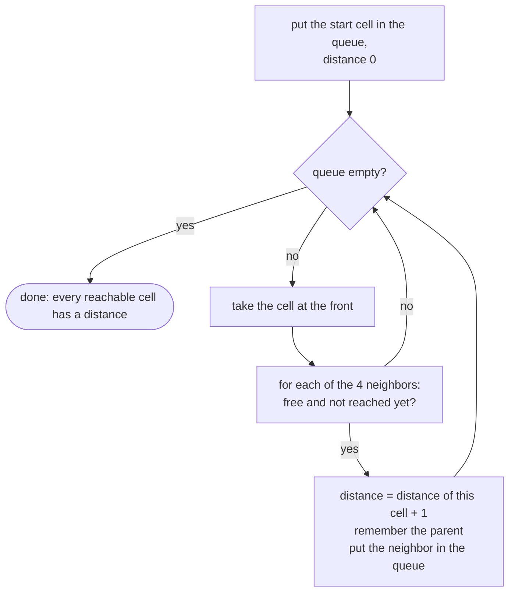
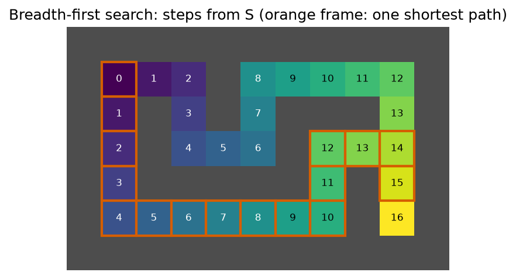
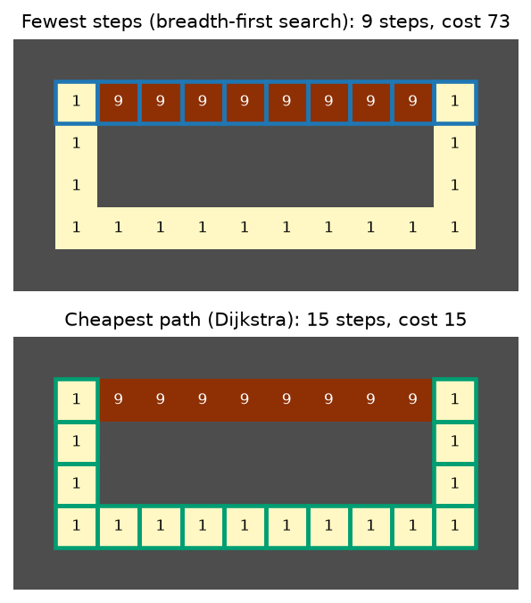
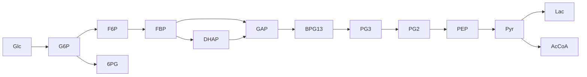

# Handout 6: Containers and Algorithms

**Session length:** about 60 minutes of core material. This is the longest handout, so treat the quick tour as a reference that you come back to. **Prerequisite:** [Handout 5](05-files.md).

A `std::vector` is a row of values, and you find a value by its position. Often you want something else: to look a value up by a **name** (how often does the codon `ATG` occur?), to keep every value only **once**, to process things in the order they arrived (a **queue**), or to always take the **smallest** next. The standard library has a container for each of these. It also has **algorithms** such as sorting, so that you do not write them yourself. With these tools you can write real graph searches: this handout finds the shortest path through a maze and the cheapest path across a terrain.

After this session you can:

- group values that belong together into a `struct` (a record),
- count things with a `std::map`, and keep unique values in a `std::set`,
- use a `std::queue` and a `std::priority_queue`,
- sort with `std::sort` and a small function written in place (a lambda),
- find the shortest path in a maze with breadth-first search, and the cheapest path with Dijkstra's algorithm,
- count k-mers in DNA sequences, translate a sequence into a protein, and compute classification measures for more than two classes.

All programs are in [`examples/06-containers`](../examples/06-containers). Their build targets are named `06_<program>`.

---

## 1. The quick tour

All snippets of this section are in [`tour.cpp`](../examples/06-containers/tour.cpp). It needs `<map>`, `<set>`, `<queue>`, `<algorithm>`, `<numeric>` and `<functional>`.

### 1.1 `struct`: a record

```cpp
struct Sample {
    std::string id;
    double rate;
};

Sample a = {"S01", 98.2};
std::cout << a.id << ": " << a.rate;                     // S01: 98.2
std::vector<Sample> samples = {{"S01", 98.2}, {"S02", 101.5}, {"S03", 99.8}, {"S04", 103.1}};
```

```text
S01: 98.2
samples: 4, last: S04
```

- **Idea:** a `struct` groups several named values (fields) into one new type. `a.id` and `a.rate` are the fields of the record `a`. A vector of records is a table with named columns, and it replaces the [parallel vectors](../notes/glossary.md#parallel-vectors) of handouts 4 and 5.
- **Trouble:** a `struct` with a `std::string` and a `double` is bigger than a number, so pass it by `const` reference (`const Sample& s`), as in handout 3. In handout 9 you will meet the `class`, which is a `struct` with protection for its fields and with its own functions. For now a `struct` is simply a record.
- **In practice:** whenever you catch yourself writing two vectors that must be kept in step, write a `struct` and one vector instead. Name the type with a capital letter and the fields with small letters.

### 1.2 `std::map`: look up a value by its key

```cpp
std::map<std::string, int> counts;
for (const std::string& codon : codons) {
    ++counts[codon];            // a missing key is created with the value 0 first
}
for (const auto& entry : counts) {
    std::cout << entry.first << " -> " << entry.second << '\n';
}
counts.count("ATG");            // 1 if the key exists, 0 if not
counts.at("TAA");               // the value, or an error if the key is missing
```

```text
codon counts:
  ATG -> 3
  GCC -> 2
  TAA -> 1
count("ATG") = 1, count("XYZ") = 0, size = 3, at("TAA") = 1
```

- **Idea:** a `std::map<Key, Value>` stores pairs of a key and a value, and **keeps them sorted by key**. `counts["ATG"]` finds the value of the key, and `++counts[codon]` is the classic way to **count** things: the first time a key is used, it is created with the value 0.
- **Trouble:** `counts[key]` **creates** the key if it does not exist, even when you only wanted to look. A misspelled key gives you a fresh entry with value 0 and no error, and it adds an entry to the map. To look without creating, use `count(key)` or `find(key)`, or `at(key)`, which stops with an error for a missing key. Looping over a map gives **pairs**: `entry.first` is the key and `entry.second` is the value. The loop above uses `auto`, which lets the compiler fill in the long type `std::pair<const std::string, int>`.
- **In practice:** use a map when you ask "how many times?" or "what belongs to this name?". Choose `operator[]` for counting, and `at()` (or `count`/`find`) for pure lookup. If you need the entries sorted by value instead of by key, copy them into a vector and sort that (section 1.5, and the k-mer example below).

### 1.3 `std::set`: every value once

```cpp
const std::set<std::string> unique(codons.begin(), codons.end());
```

```text
6 codons, 3 different: ATG GCC TAA
```

- **Idea:** a `std::set` holds each value **at most once** and keeps the values sorted. Giving it the range `codons.begin(), codons.end()` removes the duplicates in one step. `unique.size()` is the number of different values.
- **Trouble:** a set has no positions (`unique[0]` does not exist). You can only ask whether a value is in it (`count`), insert, erase and loop over it in sorted order.
- **In practice:** use a set to answer "which values occur?" and "have I seen this before?", for example to collect the different sample names or the visited nodes of a graph.

### 1.4 `std::queue` and `std::priority_queue`

```cpp
std::queue<int> line;
line.push(1); line.push(2); line.push(3);
line.front();                  // 1: the one that waited longest
line.pop();                    // removes the front element (and returns nothing)

std::priority_queue<int> largest_first;                                              // the largest comes out first
std::priority_queue<int, std::vector<int>, std::greater<int>> smallest_first;       // the smallest comes out first
```

```text
queue: 1 2 3
largest first: 8 5 3 1 
smallest first: 1 3 5 8 
```

- **Idea:** a `std::queue` serves the elements in the order in which they arrived, *first in, first out*: `push` adds at the back, `front` looks at the front, `pop` removes it. A `std::priority_queue` serves the **most important** element first. By default that is the largest. With `std::greater` as the third template argument it is the smallest.
- **Trouble:** `pop()` only removes: it does **not** give you the element, so you first read `front()` (or `top()`) and then `pop()`. Calling `front()` or `top()` on an **empty** queue is undefined behavior, so test `empty()` first. The three template arguments of a min-priority queue are awkward to write. The text above is what everybody copies.
- **In practice:** a queue gives the "level by level" order that **breadth-first search** needs. A priority queue gives the "cheapest next" order of **Dijkstra's algorithm**. Both come back in sections 3 and 4.

### 1.5 Algorithms: `sort`, `count`, `find`, `max_element`, `accumulate`

```cpp
std::vector<double> v = {3.2, 1.5, 4.8, 2.1, 1.5};
std::sort(v.begin(), v.end());                        // 1.5 1.5 2.1 3.2 4.8
std::count(v.begin(), v.end(), 1.5);                  // 2
std::find(v.begin(), v.end(), 4.8) != v.end();        // true: found
*std::max_element(v.begin(), v.end());                // 4.8
std::accumulate(v.begin(), v.end(), 0.0);             // 13.1 (header <numeric>)
```

```text
sorted: 1.5 1.5 2.1 3.2 4.8
count of 1.5: 2
contains 4.8: 1
largest: 4.8
sum: 13.1
```

- **Idea:** the library offers ready-made algorithms. They work on a **range** of a container, given by two *iterators*: `v.begin()` (the start) and `v.end()` (one past the last element). An iterator is a "finger" that points to an element. `*it` is the element it points to.
- **Trouble:** `find` and `max_element` return an iterator, not a value and not a position. A "not found" shows as `v.end()`, and you must compare with it before you use the result. Reading `*v.end()` is undefined behavior. `std::accumulate(..., 0.0)` needs the `0.0`: with `0` the sum would be done in `int`, and the decimals would be cut off at every step. The element type of the starting value decides the type of the sum.
- **In practice:** before you write a loop, ask if an algorithm does it: sorting, counting, searching, summing, finding the largest. The line with the algorithm is shorter, is tested by thousands of users, and says what it does. Write your own loop when none fits.

### 1.6 Lambdas: a small function written in place

```cpp
std::sort(samples.begin(), samples.end(),
          [](const Sample& x, const Sample& y) { return x.rate > y.rate; });

const double threshold = 100.0;
const auto above = std::count_if(samples.begin(), samples.end(),
                                 [threshold](const Sample& s) { return s.rate > threshold; });
```

```text
by rate, largest first: S04(103.1) S02(101.5) S03(99.8) S01(98.2)
samples above 100: 2
```

- **Idea:** a *lambda* is a function without a name, written right where it is used. `[](const Sample& x, const Sample& y) { return x.rate > y.rate; }` means: "given two samples, `x` comes first if its rate is larger". `std::sort` calls it to decide the order. The square brackets `[ ]` at the start list the variables of the surroundings that the lambda may use. `[threshold]` **captures** the variable `threshold`.
- **Trouble:** the syntax looks strange at first. For sorting, the lambda must be a strict "comes before" rule (`>` or `<`, never `>=` or `<=`), otherwise `std::sort` can fail in strange ways. A lambda that needs a variable of the surroundings must list it in the brackets, otherwise the compiler reports an error about an "unknown" variable.
- **In practice:** use a lambda for short one-off rules: how to compare two records, what counts as "high", what to count. If the function is long, or you need it in several places, give it a name and write it as an ordinary function (handout 3).

---

## 2. Core example: counting k-mers

### The problem

A **k-mer** is a substring of length $k$ of a DNA sequence. Counting k-mers is the first step of many sequence analyses: genome assembly, comparing sequences without aligning them, finding repeated words. Which 3-mers occur how often in each sequence of a FASTA file?

### Background

A sequence of length $n$ has $n - k + 1$ windows of length $k$. With 4 bases there are $4^k$ different possible k-mers: 64 for $k = 3$, and over a million for $k = 10$. Counting means: slide a window over the sequence, and for each window increase the counter of its text. A `std::map` from text to count is exactly that. For large genomes specialized programs (for example Jellyfish, Marçais and Kingsford) count much faster, but the idea is the same.

### The program

[`kmers.cpp`](../examples/06-containers/kmers.cpp) reads [`data/sequences.fasta`](../data/sequences.fasta) from handout 5 (three invented sequences). This time it uses a `struct`, so the identifier and the sequence stay together:

```cpp
struct Record {
    std::string id;
    std::string sequence;
};

// How often does each k-mer occur? The map keeps the k-mers sorted alphabetically.
std::map<std::string, int> count_kmers(const std::string& dna, std::size_t k)
{
    std::map<std::string, int> counts;
    for (std::size_t i = 0; i + k <= dna.size(); ++i) {
        ++counts[dna.substr(i, k)];
    }
    return counts;
}
```

A map is sorted by **key**. To show the most frequent k-mers, the program copies the entries into a vector of pairs and sorts it by count, with a lambda:

```cpp
std::vector<std::pair<std::string, int>> ranking(counts.begin(), counts.end());
std::sort(ranking.begin(), ranking.end(),
          [](const std::pair<std::string, int>& x, const std::pair<std::string, int>& y) {
              if (x.second != y.second) {
                  return x.second > y.second; // larger count first
              }
              return x.first < y.first;       // equal counts: alphabetical
          });
```

Output:

```text
k = 3: 64 different 3-mers are possible

seqA (96 bases, 94 windows): 35 different 3-mers
  most frequent:  TAT x10  AAA x7  TTA x7  TTT x7

seqB (120 bases, 118 windows): 57 different 3-mers
  most frequent:  CTT x5  GGA x5  TGG x5  GTC x4

seqC (84 bases, 82 windows): 37 different 3-mers
  most frequent:  CCC x6  AGC x5  CAG x4  CTC x4
```

I recomputed the counts independently in Python (`Counter`), and they agree.

### Walkthrough

1. `dna.substr(i, k)` cuts out the window, and `++counts[...]` counts it. The condition `i + k <= dna.size()` adds instead of subtracting, to stay safe with unsigned numbers ([size_t](../notes/glossary.md#size_t-and-unsigned-numbers)), and it covers exactly the $n - k + 1$ windows.
2. `seqA` was made AT-rich and `seqC` GC-rich. The ranking shows it: the frequent 3-mers of `seqA` consist of A and T (`TAT`, `AAA`, `TTA`, `TTT`), those of `seqC` of G and C (`CCC`, `AGC`, `CAG`, `CTC`). `seqA` also uses only 35 of the 64 possible 3-mers, because the composition is skewed.
3. The **second sorting key** is important: several k-mers have the same count (for example `AAA`, `TTA` and `TTT`, each 7 times), and the order of equal elements is otherwise not defined. Sorting alphabetically among equals makes the output the same on every computer.
4. `Record` solves the weakness of handout 5, where `ids` and `sequences` were parallel vectors. Now one `Record` holds the identifier together with its sequence, and `read_fasta` returns a `std::vector<Record>`.
5. A `std::vector<std::pair<...>>` constructed from `counts.begin(), counts.end()` is the standard way to get the contents of a map into a form that can be sorted by value.

---

## 3. Core example: the shortest path through a maze (breadth-first search)

### The problem

What is the shortest way from `S` to `G` in the maze of handouts 4 and 5, counted in steps?

### Background

**Breadth-first search (BFS)** explores the maze in rings. First all cells 1 step from the start, then all cells 2 steps away, and so on. The first time it reaches a cell, it has found the **shortest** way there, and it remembers which cell it came from (the *parent*). A queue keeps the cells that have been reached but whose neighbors have not been looked at yet: first in, first out gives exactly the ring-by-ring order.



Every cell is put in the queue at most once, and each cell has 4 neighbors, so the work grows in proportion to the number of cells. BFS is correct when **all steps cost the same**. The distance table of handout 4 (`-1` for "not reached") is exactly the memory that BFS needs.

### The program

[`maze_bfs.cpp`](../examples/06-containers/maze_bfs.cpp): version 5 of the **search thread**. The maze comes from [`data/maze.txt`](../data/maze.txt). The core:

```cpp
struct Cell {
    int row;
    int col;
};

// distance[r][c] = steps from the start, -1 = not reached yet. parent[r][c] = the cell we came from.
std::vector<std::vector<int>> distance(rows, std::vector<int>(cols, -1));
std::vector<std::vector<Cell>> parent(rows, std::vector<Cell>(cols, Cell{-1, -1}));

const int step_row[4] = {-1, 1, 0, 0}; // up, down, left, right
const int step_col[4] = {0, 0, -1, 1};

std::queue<Cell> frontier; // cells that are reached, but whose neighbors are not looked at yet
distance[start.row][start.col] = 0;
frontier.push(start);
while (!frontier.empty()) {
    const Cell current = frontier.front();
    frontier.pop();
    for (int k = 0; k < 4; ++k) {
        const int r = current.row + step_row[k];
        const int c = current.col + step_col[k];
        const bool inside = r >= 0 && r < rows && c >= 0 && c < cols;
        if (inside && maze[r][c] != '#' && distance[r][c] == -1) {
            distance[r][c] = distance[current.row][current.col] + 1;
            parent[r][c] = current;
            frontier.push(Cell{r, c});
        }
    }
}
```

After the search the program walks back from `G` through the parents and marks the path with `*`. Output:

```text
Cells reached from S: 30
Shortest path from S to G: 15 steps

Path:
###########
#S..#.....#
#*#.#.###.#
#*#...#***#
#*#####*#G#
#*******#.#
###########

Distance table (### wall, number = steps from S, . = not reached):
#################################
###  0  1  2###  8  9 10 11 12###
###  1###  3###  7######### 13###
###  2###  4  5  6### 12 13 14###
###  3############### 11### 15###
###  4  5  6  7  8  9 10### 16###
#################################
```



### Walkthrough

1. The two tables `distance` and `parent` have the shape of the maze. This is the table of handout 4, now filled by the search. All 30 free cells are reached, so the maze has no sealed-off pocket.
2. The four directions are kept in two small arrays, and the loop over `k` replaces four copies of the same code. The test `inside && maze[r][c] != '#' && ...` checks the limits **before** it looks at `maze[r][c]`, because `&&` stops at the first false part. Switch the order and you read outside the maze.
3. A cell gets its distance when it is **first** reached, and the condition `distance[r][c] == -1` stops it from being reached again. That is why every cell enters the queue once.
4. **The path is not unique.** There are two shortest paths of 15 steps (I counted them with an independent Python program): the one along the bottom that is marked, and one through the top. BFS reports the one it finds first, which depends on the order of the four directions (up, down, left, right). Another order may print the other one. The distance of 15 is the same.
5. `parent[goal]`, `parent[parent[goal]]`, ... leads back to the start. This is how every search algorithm turns a table of distances into an actual path.
6. `std::queue<Cell>` holds records of type `Cell`: containers hold any type, including your own.

---

## 4. Core example: the cheapest path (Dijkstra's algorithm)

### The problem

Breadth-first search counts **steps**. A terrain, however, has different **costs**: mud, water or a steep slope cost more than a path. The file [`data/terrain.txt`](../data/terrain.txt) gives the cost of entering each cell as a digit:

```text
############
#S99999999G#
#1########1#
#1########1#
#1111111111#
############
```

The straight way along the top has 9 steps, but each cell costs 9. The way around is much longer but cheap. Which one is better depends on what you count.

### Background

**Dijkstra's algorithm** finds the **cheapest** path when all costs are positive. It keeps for every cell the cheapest cost found so far, and always expands the cell with the **smallest cost so far** next. A priority queue gives it in one step. When a neighbor can be reached more cheaply through the current cell, its cost and parent are updated. In formulas, for the current cell $u$ and a neighbor $v$ with cost $w(v)$ to enter:

$$\text{cost}[v] \leftarrow \min\bigl(\text{cost}[v],\; \text{cost}[u] + w(v)\bigr)$$

Because the cell with the smallest cost is expanded first, its cost can no longer be improved: this is why the algorithm works, and why negative costs would break it. If all costs are equal, Dijkstra's algorithm does the same as BFS (the priority queue then behaves like a queue).

### The program

[`terrain_dijkstra.cpp`](../examples/06-containers/terrain_dijkstra.cpp) runs **both** searches on the terrain, so that the difference is visible. The priority queue holds pairs of (cost so far, cell number):

```cpp
// (cost so far, cell number = row * cols + col). A pair is compared by its first element first.
using Item = std::pair<int, int>;

// std::greater turns the priority queue upside down: the SMALLEST cost comes out first.
std::priority_queue<Item, std::vector<Item>, std::greater<Item>> frontier;
cost[start.row][start.col] = 0;
frontier.push(Item(0, start.row * cols + start.col));
while (!frontier.empty()) {
    const Item top = frontier.top();
    frontier.pop();
    const int r0 = top.second / cols;
    const int c0 = top.second % cols;
    if (top.first > cost[r0][c0]) {
        continue; // an outdated entry: a cheaper way to this cell was found meanwhile
    }
    for (int k = 0; k < 4; ++k) {
        const int r = r0 + step_row[k];
        const int c = c0 + step_col[k];
        if (!can_enter(grid, r, c)) {
            continue;
        }
        const int new_cost = top.first + cell_cost(grid[r][c]);
        if (new_cost < cost[r][c]) {
            cost[r][c] = new_cost;
            parent[r][c] = Cell{r0, c0};
            frontier.push(Item(new_cost, r * cols + c));
        }
    }
}
```

Output:

```text
terrain.txt: 6 rows, 12 columns
A digit is the cost of entering the cell, # is a wall.

Fewest steps (breadth-first search): 9 steps, cost 73
############
#S********G#
#1########1#
#1########1#
#1111111111#
############

Cheapest path (Dijkstra): 15 steps, cost 15
############
#S99999999G#
#+########+#
#+########+#
#++++++++++#
############
```



An independent Python implementation of both searches (with a different data structure) gives the same results: 9 steps at cost 73, and cost 15 in 15 steps.

### Walkthrough

1. **The two answers differ, and both are correct.** BFS minimizes the number of steps (9) and pays 73 for it. Dijkstra minimizes the cost (15) and needs 15 steps. The tool must fit the question. A path-finder for a hiker needs costs, not just steps.
2. `std::pair<int, int>` holds two values. A pair is compared by its first element, and by the second if the first are equal, so `(cost, cell)` pairs come out in order of cost. The cell is stored as a single number `row * cols + col`, which `/ cols` and `% cols` turn back into row and column.
3. A cell can be put in the queue **several times**, whenever a cheaper way to it is found. The queue has no way to remove the old entry. Therefore the algorithm throws an outdated entry away when it comes out (`top.first > cost[r0][c0]`). This idiom is the standard way to use `std::priority_queue` for Dijkstra.
4. The cost is the cost of **entering** a cell, and the start costs nothing. Starting and goal cells cost 1 in this example.
5. With `std::greater<Item>` the smallest pair comes first. Without it, the priority queue would serve the **most expensive** cell first, and the result would be wrong without any error message.
6. In handout 10, the A* algorithm improves Dijkstra's idea with an estimate of the remaining distance to the goal. It will use this terrain again.

---

## 5. Same problem, new tool

### The element table, for the last time

The table of five elements (handout 1) became a vector loop in handout 4, with the weakness of four parallel vectors. [`element_table_v3.cpp`](../examples/06-containers/element_table_v3.cpp) uses a `struct` and a `std::map`:

```cpp
struct Element {
    int number;
    std::string symbol;
    std::string name;
    double mass;
};

// ... std::vector<Element> elements = {{1, "H", "Hydrogen", 1.008}, ...};

std::map<std::string, double> mass_of;
for (const Element& e : elements) {
    mass_of[e.symbol] = e.mass;
}
const double water = 2 * mass_of.at("H") + mass_of.at("O");
```

The output is **identical, line by line,** to that of `element_table.cpp` and `element_table_v2.cpp` (compared by program). The data are now one record per element, and the molar mass of water uses `mass_of.at("H")` instead of `masses[0]`, which only worked as long as hydrogen was the first entry.

### The threads

| Thread | Handout 5 | Now (handout 6) | Next |
|---|---|---|---|
| Search | the maze read from a file | breadth-first search (steps), Dijkstra on a terrain (costs) | handout 9: `Grid` and `Node` classes, handout 10: A* with a choice of heuristic |
| Classification | scores from a file, precision, recall, F1 for two classes | per-class measures for several classes (extra 6.5) | handout 7: ROC curve, handout 9: `ConfusionMatrix` class |
| Simulation | CSV output, parameters from a file | not in this handout | handout 7: Euler against Runge-Kutta |

---

## 6. Extra examples

Pick what interests you. Each is a complete program in `examples/06-containers`, and its results were checked independently.

### 6.1 Word frequencies: [`word_frequency.cpp`](../examples/06-containers/word_frequency.cpp)

Which words occur most often in a text? The text is invented. A `map` counts, the entries are copied into a vector, and a lambda sorts them by count (like the k-mers).

```cpp
std::string clean(const std::string& word)   // keep only letters, in lower case
{
    std::string result;
    for (char c : word) {
        if (std::isalpha(static_cast<unsigned char>(c))) {
            result.push_back(static_cast<char>(std::tolower(static_cast<unsigned char>(c))));
        }
    }
    return result;
}
```

```text
22 words, 12 different

  the: 6
  enzyme: 3
  substrate: 3
  binds: 2
  a: 1
```

**What to notice**

- `stream >> word` reads one word at a time (handout 5), and `clean` removes punctuation and capital letters, so that `"The"` and `"the"` count as one word. Without cleaning, `"substrate."` and `"substrate"` would be different words.
- `std::isalpha` and `std::tolower` (from `<cctype>`) want a value converted with `static_cast<unsigned char>`. Without the cast, a character with a negative code (an accented letter, for example) is undefined behavior.
- The tie between `enzyme` and `substrate` (3 each) is broken alphabetically, as in the k-mer example.

### 6.2 Translating DNA into protein: [`codon_usage.cpp`](../examples/06-containers/codon_usage.cpp)

The genetic code is a lookup table from 64 codons to 20 amino acids and a stop signal, which is a `std::map<std::string, char>`. The program builds it from a compact 64-letter string and translates a coding sequence.

```cpp
// The standard genetic code as 64 letters. The codons are ordered by their bases in the order T, C, A, G.
const std::string amino_acids = "FFLLSSSSYY**CC*WLLLLPPPPHHQQRRRRIIIMTTTTNNKKSSRRVVVVAAAADDEEGGGG";
const std::string bases = "TCAG";
std::map<std::string, char> code;
std::size_t index = 0;
for (char first : bases) {
    for (char second : bases) {
        for (char third : bases) {
            code[std::string{first, second, third}] = amino_acids[index];
            ++index;
        }
    }
}
```

```text
genetic code: 64 codons
DNA:     ATGGCCATTGTAATGGGCCGCTGAAAGGGTGCCCGATAG (39 bases)
protein: MAIVMGR*KGAR* (* = stop)

codons used more than once:
  ATG (M) x2
  GCC (A) x2
ATG -> M, TGG -> W, TAA -> *
```

**What to notice**

- Three nested loops over `"TCAG"` produce all 64 codons in the order of the 64-letter string. This is how the table is built without typing 64 lines. The map is then used for lookup: `code.at(codon)`.
- `code.at(codon)` is used instead of `code[codon]`: a codon that is not in the table (for example one with an `N`) must produce an error, not silently create a new entry.
- The translation is checked against a hand translation of every codon (ATG M, GCC A, ATT I, GTA V, ATG M, GGC G, CGC R, TGA stop, AAG K, GGT G, GCC A, CGA R, TAG stop). The protein `MAIVMGR*KGAR*` has 13 symbols, and the stop codons are marked `*`.
- The sequence has stop codons in the middle (`TGA`). A real translator would stop at the first one. This example translates all of it, to show the code.
- The table is the *standard* genetic code. Mitochondria and some organisms use variants, in which a few codons mean something else (Crick and colleagues showed in 1961 that the code is read in groups of three bases).

### 6.3 Sorting records with lambdas: [`sort_records.cpp`](../examples/06-containers/sort_records.cpp)

The nine usable measurements of handout 5 as a vector of `Sample` records, sorted in three ways:

```text
By rate, largest first:
  S12  treated  121.3
  S08  treated  118.7
  ...
  S10  control  97.6

By group, then by rate:
  S10  control  97.6
  S01  control  98.2
  ...
  S12  treated  121.3

Samples with a rate above 110: 4 of 9
```

(The lists are shortened here. The full output is in the program.)

**What to notice**

- Sorting by **two keys** is one lambda: compare the groups first, and only if they are equal compare the rates.
- The same records can be sorted in any order, any number of times, because they are one vector of records. With parallel vectors the sorted order of one vector would have to be copied to all the others.
- `[threshold]` captures the variable. The result of `std::count_if` has the type `auto`, which here is a signed integer type of the library. We only print it.

### 6.4 A path through a metabolic network: [`metabolic_path.cpp`](../examples/06-containers/metabolic_path.cpp)

A metabolic network is a graph: the nodes are metabolites, and an arrow means that one enzymatic step can turn one into the next. A graph with names as nodes is a `std::map<std::string, std::vector<std::string>>`: for each metabolite, the list of its successors. The graph here is a strongly simplified glycolysis with two neighbors: the pentose phosphate pathway (`6PG`) and the end products lactate and acetyl-CoA. BFS finds the shortest reaction path.



Abbreviations: Glc glucose, G6P glucose 6-phosphate, F6P fructose 6-phosphate, FBP fructose 1,6-bisphosphate, DHAP dihydroxyacetone phosphate, GAP glyceraldehyde 3-phosphate, BPG13 1,3-bisphosphoglycerate, PG3 and PG2 3- and 2-phosphoglycerate, PEP phosphoenolpyruvate, Pyr pyruvate, Lac lactate, AcCoA acetyl-CoA, 6PG 6-phosphogluconate.

```text
Metabolites with outgoing reactions: 11
Glc -> Pyr: 9 steps: Glc > G6P > F6P > FBP > GAP > BPG13 > PG3 > PG2 > PEP > Pyr
Glc -> Lac: 10 steps: Glc > G6P > F6P > FBP > GAP > BPG13 > PG3 > PG2 > PEP > Pyr > Lac
DHAP -> Pyr: 6 steps: DHAP > GAP > BPG13 > PG3 > PG2 > PEP > Pyr
Pyr -> Glc: no path in this network
```

**What to notice**

- The same BFS as in the maze, but the nodes are **text**: the `parent` map doubles as the set of reached nodes (`parent.count(next) == 0` means "not reached yet"), and the queue holds names.
- `FBP -> GAP` is shorter than `FBP -> DHAP -> GAP`, so BFS skips the detour through DHAP.
- `Pyr -> Glc` has no path, because the arrows are one-directional and the network is **simplified**: in a cell the reverse direction needs different enzymes. The program reports "no path" instead of failing. A real analysis would use a curated database, not this sketch.
- `graph.find(current)` returns an iterator, and `found->second` is the list of successors. The `->` is short for `(*found).second` (section 1.5).

### 6.5 More than two classes: [`multiclass_metrics.cpp`](../examples/06-containers/multiclass_metrics.cpp)

Handout 5 computed precision, recall and F1 for two classes. What happens with three, say `healthy`, `benign` and `malignant`? Each class gets its own measures: for the class, the others count as "negative". Per class, a `std::map<std::string, int>` counts the true positives, false positives and false negatives. The data are invented.

```text
class       support precision    recall        F1
healthy          18     0.850     0.944     0.895
benign            8     0.571     0.500     0.533
malignant         4     0.667     0.500     0.571

macro-averaged F1 (mean of the class F1 values): 0.666
micro-averaged F1 (all counts pooled):           0.767
accuracy (23 of 30 correct):                      0.767
```

An independent calculation in Python (counts per class, formulas written out) gives the same table.

**What to notice**

- **Macro** average: compute the measure for each class, then take the plain mean. Every class counts the same, however small it is. **Micro** average: pool all the counts first, then compute the measure once. Large classes dominate it. For a single-label problem like this, micro-F1 equals the **accuracy** (0.767). That is why it adds no new information here.
- The two averages **differ** (0.666 against 0.767), because the classifier is good at the big class (`healthy`, F1 0.895) and poor at the two small ones (about 0.55). The macro average exposes this. The accuracy hides it, as in the "always healthy" example of handout 4.
- `tp[name]` on a map creates a missing key with the value 0. Here this is exactly right (a class without errors has count 0). In section 1.2 it was a trap.
- The helper `ratio` returns NaN for an undefined ratio (0 divided by 0), as in handout 5, and the table prints `n/a`.

---

## 7. Summary

- A `struct` groups the fields of one record. A vector of records replaces parallel vectors.
- `std::map` finds a value by key, keeps the keys sorted, and `++counts[key]` counts. `counts[key]` creates a missing key, `at(key)` stops with an error instead, and `count(key)` only asks.
- `std::set` keeps each value once. `std::queue` serves first-in-first-out, `std::priority_queue` serves the largest (or with `std::greater` the smallest) first. `pop()` does not return the element.
- Algorithms work on ranges `begin()` to `end()`. Use `sort`, `count`, `find`, `max_element`, `accumulate` before you write a loop. Compare the result of `find` with `end()`.
- A lambda is a small function written in place, and `[x]` captures a variable. A sorting rule must use `<` or `>`, and should resolve ties.
- **Breadth-first search** (queue) finds the path with the fewest steps. **Dijkstra's algorithm** (priority queue) finds the cheapest path when all costs are positive. The two can disagree, and the question decides which one to use.
- A table of distances plus a table of parents turns a search into a path.
- Macro and micro averages answer different questions. A weak small class shows in the macro average, and the accuracy hides it.

## References

All addresses and DOIs were checked on 2026-11-22. The results of the programs were also checked with independent Python code. Two pages of the NCBI could not be checked automatically, so they are not cited.

1. E. W. Dijkstra, "A note on two problems in connexion with graphs", *Numerische Mathematik* **1**, 269-271 (1959). doi:[10.1007/BF01386390](https://doi.org/10.1007/BF01386390)
2. T. H. Cormen, C. E. Leiserson, R. L. Rivest, C. Stein, *Introduction to Algorithms*, 4th ed., MIT Press, 2022. ISBN 978-0-262-04630-5. The chapters on elementary graph algorithms (breadth-first search) and single-source shortest paths (Dijkstra's algorithm).
3. G. Marçais, C. Kingsford, "A fast, lock-free approach for efficient parallel counting of occurrences of k-mers", *Bioinformatics* **27**, 764-770 (2011). doi:[10.1093/bioinformatics/btr011](https://doi.org/10.1093/bioinformatics/btr011)
4. F. H. C. Crick, L. Barnett, S. Brenner, R. J. Watts-Tobin, "General nature of the genetic code for proteins", *Nature* **192**, 1227-1232 (1961). doi:[10.1038/1921227a0](https://doi.org/10.1038/1921227a0)
5. J. M. Berg, J. L. Tymoczko, L. Stryer, *Biochemistry*, W. H. Freeman (many editions, for example the 9th, 2019, ISBN 978-1-319-11467-1). The chapter on glycolysis.
6. M. Sokolova, G. Lapalme, "A systematic analysis of performance measures for classification tasks", *Information Processing & Management* **45**, 427-437 (2009). doi:[10.1016/j.ipm.2009.03.002](https://doi.org/10.1016/j.ipm.2009.03.002). (Macro and micro averaging.)
7. B. Stroustrup, *A Tour of C++*, 3rd ed., Addison-Wesley, 2022. <https://www.stroustrup.com/tour3.html>
8. cppreference.com: [`std::map`](https://en.cppreference.com/w/cpp/container/map), [`std::set`](https://en.cppreference.com/w/cpp/container/set), [`std::queue`](https://en.cppreference.com/w/cpp/container/queue), [`std::priority_queue`](https://en.cppreference.com/w/cpp/container/priority_queue), [`std::pair`](https://en.cppreference.com/w/cpp/utility/pair), [`std::sort`](https://en.cppreference.com/w/cpp/algorithm/sort), [`std::count_if`](https://en.cppreference.com/w/cpp/algorithm/count_if), [lambda expressions](https://en.cppreference.com/w/cpp/language/lambda).
